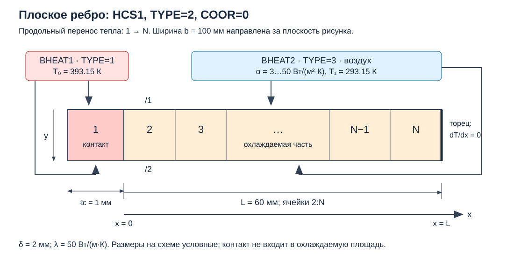
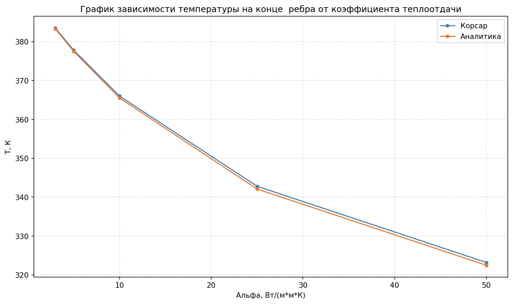
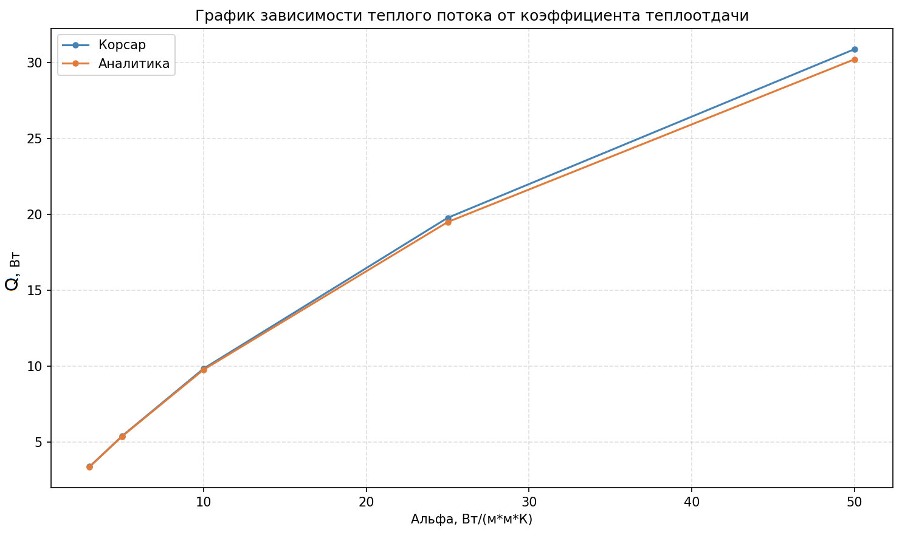
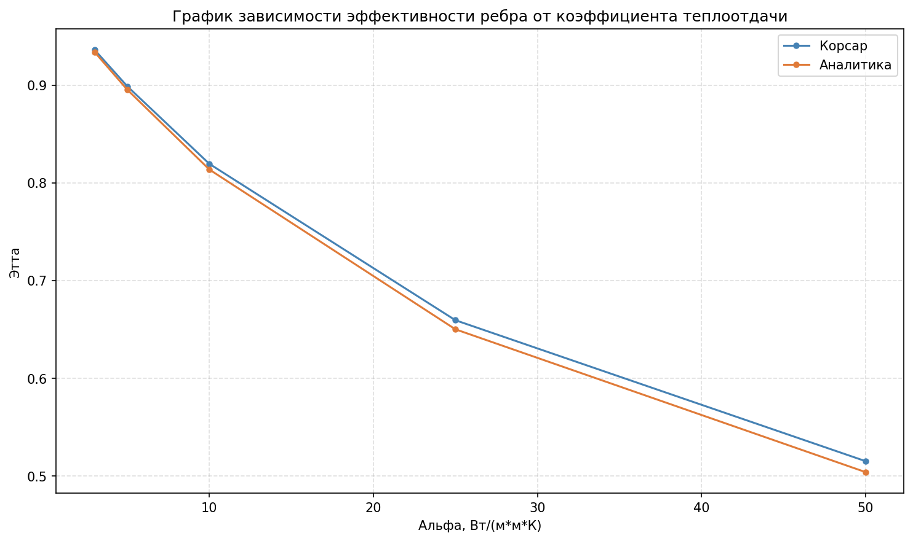

# Лабораторная работа № 9. Стационарная теплопроводность в плоском ребре


## 1. Цель работы

Собрать в КОРСАР расчетную схему для моделирования прямоугольного плоского ребра с температурой основания $T_0$, охлаждаемого воздухом при температуре $T_1$. Найти температуру конца ребра, распределение температуры по высоте и мощность теплоотдачи. Сравнить численное решение с аналитическим.

### Навыки, приобретаемые по результатам выполнения работы

- Моделирование ребра элементом с двумерной теплопроводностью (HCS, TYPE=2);
- Проверка теплового баланса;
- Исследование сеточной сходимости.

---

## 2. Описание постановки задачи

### 2.1. Геометрия, допущения и нодализация

Рассматривается ребро постоянной толщины $\delta$, ширины $b$ и высоты охлаждаемой части $L$. Координата $x$ направлена **от несущей оребренной поверхности к концу ребра, от ячейки 1 к ячейке N**; координата $y$ — поперек толщины, от поверхности `/1` к `/2`. Ширина ребра перпендикулярна плоскости рисунка.

Обе широкие поверхности охлаждаемой части обмениваются теплом с воздухом при одинаковых постоянных $\alpha$ и $T_1$. Узкие боковые кромки и торец теплоизолированы. Излучение, внутреннее энерговыделение и зависимость свойств от температуры отсутствуют. Поэтому площадь сечения $A_c = b\delta = 2{\cdot}10^{-4}$ м², охлаждаемый периметр $P = 2b = 0{,}2$ м, площадь теплоотдачи $A_f = PL = 0{,}012$ м². Охлаждением узких кромок в этой постановке пренебрегается.

<a id="fig-nodal"></a>



*Рисунок 1 — Продольная теплопроводность HCS и граничные условия BHEAT.*

Для моделирования ребра необходима **двумерная** модель теплопроводности: ребро задается элементом HCS с ключом `TYPE=2`, продольная (по $x$) теплопроводность включена, поперечные градиенты учитываются автоматически.

### 2.2. Исходные данные и выбор параметров


| Параметр                                          | Значение       |
|-----------------------------------------------------------|-----------------------:|
| Высота охлаждаемой части $L$        | 0.060 м               |
| Толщина $\delta$                                  | 0.002 м               |
| Ширина $b$                                          | 0.100 м               |
| Длина контактной ячейки $\ell_c$    | 0.001 м               |
| Теплопроводность $\lambda$               | 50 Вт/(м·К)       |
| Плотность $\rho$                                | 7800 кг/м³         |
| Теплоемкость $c$                              | 500 Дж/(кг·К)    |
| Температура основания $T_0$           | 120 °C = 393.15 К    |
| Температура воздуха $T_1$               | 20 °C = 293.15 К     |
| Коэффициенты теплоотдачи $\alpha$ | 3…50 Вт/(м²·К) |


### 2.3. Математическая модель и аналитическое решение

При малом $\mathrm{Bi}_\delta = \alpha\delta/(2\lambda)$ температура сечения почти однородна; в рассматриваемых вариантах $\mathrm{Bi}_\delta \le 0{,}001$, поэтому двумерное поле HCS сравнивается с одномерным решением.

Уравнение и граничные условия для охлаждаемой части:

<a id="eq-fin"></a>

$$
\lambda A_c\dfrac{d^2T}{dx^2} - \alpha P(T-T_1) = 0, \qquad T(0) = T_0, \qquad \left.\dfrac{dT}{dx}\right|_{L} = 0. \tag{1}
$$

Введем $\theta = (T-T_1)/(T_0-T_1)$, $\xi = x/L$, $m = \sqrt{\alpha P/(\lambda A_c)} = \sqrt{2\alpha/(\lambda\delta)}$, $M = mL$. Решение для теплоизолированного торца и мощность теплоотдачи (Holman [[2]](#ref-holman); открытый вывод — MIT [[3]](#ref-mit)):

<a id="eq-profile"></a>

$$
\theta(\xi) = \dfrac{\cosh[M(1-\xi)]}{\cosh M}, \qquad T(L) = T_1 + \dfrac{T_0-T_1}{\cosh M}. \tag{2}
$$

<a id="eq-power"></a>

$$
\dot Q = -\lambda A_cT'(0) = \lambda A_cm(T_0-T_1)\tanh M = \alpha\int_0^L P[T(x)-T_1]dx. \tag{3}
$$

<a id="eq-efficiency"></a>

$$
\eta_f = \dfrac{\dot Q}{\alpha A_f(T_0-T_1)} = \dfrac{\tanh M}{M}. \tag{4}
$$

Эффективность $\eta_f$ — отношение мощности ребра к мощности изотермического ребра той же площади при $T_0$, т. е. отношение средней относительной температуры ребра к температуре его основания. Аналитическое решение приводится также в учебнике Михеева [[4]](#ref-miheev), разд. 10-6.

---

## 3. Требуемые результаты

- Нодализация задачи, постановка, исходные данные;
- Профили температуры по высоте, мощности подвода и теплоотдачи, проверка баланса;
- Зависимость эффективности от $\alpha$;
- Скрипты обработки, расчета аналитики и отклонений; сводные таблицы сходимости;
- Вывод о достаточном разбиении, точности представления контакта и границах одномерного приближения.

---

## 4. Ход выполнения работы

Для выполнения задачи были созданы файлы задачи `kordat` и обработки данных `kutdat` для всех расчетных вариантов. Нодализация задачи представлена на рисунке [1](#fig-nodal).

Схема собрана следующим образом:

- ребро задано элементом **HCS** с `TYPE=2` (двумерная теплопроводность): $N$ ячеек по высоте ($x$, ключи `N`, `XL`), $K$ ячеек по толщине ($y$); продольная теплопроводность включена, направление от несущей оребренной поверхности к концу ребра совпадает с осью $x$;
- **ячейка 1** — контактная, длина $\ell_c = 0{,}001$ м: задана температура границ ячейки $T_0 = 393{,}15$ К;
- **ячейки 2…N** — охлаждаемые: на поверхностях `/1` и `/2` задано граничное условие BHEAT с коэффициентами теплоотдачи $\alpha = 3$…50 Вт/(м²·К) и температурой воздуха $T_1 = 293{,}15$ К; торец и узкие кромки — адиабатические.

В качестве начальных условий принималось равномерное поле $T = T_0$ во всех ячейках. Для вывода расчетной схемы в стационарный режим расчет выполнялся до времени $t = 5000$ с, что превышает ориентир установления стационарности $10L^2/a \approx 2808$ с, где температуропроводность $a = \lambda/(\rho c) = 1{,}28\cdot10^{-5}$ м²/с. Вывод расчетных значений (температур ячеек и тепловых потоков) осуществляется с периодичностью 5000 с, так как интерес представляют только вышедшие на статику значения параметров.

Выполнен контрольный расчет при $T_0 = T_1$: поле температуры равномерно и совпадает с $T_1$, мощность теплоотдачи равна нулю — схема собрана корректно. Проверены площади обеих сторон, выполнен расчет с выключенной продольной теплопроводностью.

Выполнены вариантные расчеты по $\alpha$. За варианты коэффициента теплоотдачи были взяты значения: 3, 5, 10, 25, 50 Вт/(м²·К).

Построены $T(x)$ и $\theta(\xi)$ для всех $\alpha$, графики $T(L)$, $\dot Q$ и $\eta_f$ от $\alpha$; наложена аналитика.


*Рисунок 2 — Температурный профиль T(x) при α = 3 Вт/(м²·К).*


*Рисунок 3 — Относительный температурный профиль θ(ξ) при α = 3 Вт/(м²·К).*


*Рисунок 4 — Температурный профиль T(x) при α = 5 Вт/(м²·К).*


*Рисунок 5 — Относительный температурный профиль θ(ξ) при α = 5 Вт/(м²·К).*


*Рисунок 6 — Температурный профиль T(x) при α = 10 Вт/(м²·К).*


*Рисунок 7 — Относительный температурный профиль θ(ξ) при α = 10 Вт/(м²·К).*


*Рисунок 8 — Температурный профиль T(x) при α = 25 Вт/(м²·К).*


*Рисунок 9 — Относительный температурный профиль θ(ξ) при α = 25 Вт/(м²·К).*


*Рисунок 10 — Температурный профиль T(x) при α = 50 Вт/(м²·К).*


*Рисунок 11 — Относительный температурный профиль θ(ξ) при α = 50 Вт/(м²·К).*



*Рисунок 12 — Температура конца ребра T(L) в зависимости от α (численно и аналитически).*



*Рисунок 13 — Мощность теплоотдачи Q̇ в зависимости от α (численно и аналитически).*



*Рисунок 14 — Эффективность ребра η_f в зависимости от α (численно и аналитически).*

Для $\alpha = 3$ и 50 выполнены расчеты на сетках $N-1 = 5...50$ ячеек при постоянных $L$, $\ell_c$ и $K$. Были взяты количества ячеек: 5, 10, 20, 30, 40, 50. Затем было проверено $K = 3, 5, 7$ при фиксированной продольной сетке. Было произведено сравнение разности температур середины толщины и поверхностей.

**Сходимость по числу ячеек по высоте, α = 3:**


*Рисунок 15 — α = 3, N-1 = 5.*


*Рисунок 16 — α = 3, N-1 = 10.*


*Рисунок 17 — α = 3, N-1 = 20.*


*Рисунок 18 — α = 3, N-1 = 30.*


*Рисунок 19 — α = 3, N-1 = 40.*


*Рисунок 20 — α = 3, N-1 = 50.*

**Сходимость по числу ячеек по высоте, α = 50:**


*Рисунок 21 — α = 50, N-1 = 5.*


*Рисунок 22 — α = 50, N-1 = 10.*


*Рисунок 23 — α = 50, N-1 = 20.*


*Рисунок 24 — α = 50, N-1 = 30.*


*Рисунок 25 — α = 50, N-1 = 40.*


*Рисунок 26 — α = 50, N-1 = 50.*

**Влияние числа ячеек по толщине K (при фиксированной продольной сетке):**


*Рисунок 27 — α = 3, K = 3.*


*Рисунок 28 — α = 3, K = 5.*


*Рисунок 29 — α = 3, K = 7.*


*Рисунок 30 — α = 50, K = 3.*


*Рисунок 31 — α = 50, K = 5.*


*Рисунок 32 — α = 50, K = 7.*


*Рисунок 33 — Сравнение результатов по K при α = 3.*


*Рисунок 34 — Сравнение результатов по K при α = 50.*

Был произведен самый подробный расчет для $\alpha = 50$ при количестве ячеек по длине 50 и по толщине 7.

---

## 5. Получение результатов работы

Для получения результатов необходимо:

- выполнить запуск кода КОРСАР при помощи команды

```cmd
START.bat
```

- после окончания расчета выполнить процессинг бинарного файла результатов расчета `korres` при помощи команды

```cmd
PROC.bat
```

- выполнить обработку результатов (приложение Python): построение профилей $T(x)$ и $\theta(\xi)$, графиков $T(L)$, $\dot Q$ и $\eta_f$ от $\alpha$ с наложением аналитики, расчет отклонений и сводные таблицы сходимости.

---

## 6. Сравнение с аналитическим решением

Для проверки результатов расчета использовалось аналитическое решение формулы (2)–(4). Полученные расчетные оценки:


| $\alpha$, Вт/(м²·К) | $T(L)$, К | $\dot Q$, Вт | $\eta_f$ |
|---------------------------:|-----------:|----------------:|----------:|
| 3                          | 383.2435   | 3.3614          | 0.9337    |
| 5                          | 377.5051   | 5.3705          | 0.8951    |
| 10                         | 365.5023   | 9.7623          | 0.8135    |
| 25                         | 342.0889   | 19.5            | 0.65      |
| 50                         | 322.4829   | 30.2317         | 0.5039    |


С помощью приложения [`Q_eta_calculator`](https://github.com/ArtemNarimanov/Q_eta_calculator), написанного на Python, из результатов КОРСАР получены следующие значения:


| $\alpha$, Вт/(м²·К) | $T(L)$, К | $\dot Q$, Вт | $\eta_f$ |
|---------------------------:|-----------:|----------------:|----------:|
| 3                          | 383.5      | 3.37            | 0.936     |
| 5                          | 377.8      | 5.391           | 0.8986    |
| 10                         | 366        | 9.831           | 0.8193    |
| 25                         | 342.8      | 19.78           | 0.6593    |
| 50                         | 323.2      | 30.9            | 0.5151    |


В SMath Solver получены отклонения данных на основе Корсара от аналитической оценки:


| $\alpha$, Вт/(м²·К) | $\Delta T(L)$, К | $\Delta\dot Q$, Вт | $\Delta\eta_f$ |
|---------------------------:|-------------------:|-----------------------:|-----------------:|
| 3                          | 0.2565             | 0.0086                 | 0.0023           |
| 5                          | 0.2949             | 0.0205                 | 0.0035           |
| 10                         | 0.4977             | 0.0687                 | 0.0058           |
| 25                         | 0.7111             | 0.28                   | 0.0093           |
| 50                         | 0.7171             | 0.6683                 | 0.0112           |


В SMath Solver получены отклонения в процентах:


| $\alpha$, Вт/(м²·К) | $T(L)$, % | $\dot Q$, % | $\eta_f$, % |
|---------------------------:|----------:|-------------:|-------------:|
| 3                          | 0.0669    | 0.2552       | 0.2457       |
| 5                          | 0.0781    | 0.3803       | 0.3895       |
| 10                         | 0.136     | 0.6988       | 0.7079       |
| 25                         | 0.2074    | 1.4156       | 1.4106       |
| 50                         | 0.2219    | 2.1628       | 2.1743       |


Самое подробное решение представлено вариантом с альфой 50, количеством ячеек по высоте 50, количеством ячеек по толщине 7. Аналитическое решение с такой же сеткой сделано в SMath Solver.

Отклонения результатов, полученных в РК Корсар, от аналитической оценки посчитаны по формуле:

$$
\Delta T_i = T_i^{\text{КОРСАР}} - T_i^{\text{ан}}.
$$

Максимальное отклонение посчитано по формуле:

$$
\Delta T_{\max} = \max_{1\le i\le n}\left\lvert\Delta T_i\right\rvert.
$$

Максимальное отклонение составляет 3,47 К, это 1,1837 %

Среднее отклонение посчитано по формуле

$$
\operatorname{MAE} = \frac{1}{n}\sum_{i=1}^{n}\left\lvert\Delta T_i\right\rvert.
$$

Среднее отклонение составило 1,5659 К.

Среднеквадратичное отклонение посчитано по формуле:

$$
\operatorname{RMSE} = \sqrt{\frac{1}{n}\sum_{i=1}^{n}(\Delta T_i)^2}.
$$

Оно составило 1,7832 К.

Проведены расчеты на сеточную сходимость по длине. Результаты для варианта с альфой 50 показаны в таблице:


| $N-1$ | $T(L)$, К | $\dot Q$, Вт | $\eta_f$ |
|------:|-----------:|----------------:|----------:|
| 5     | 328.5      | 35.44           | 0.5906    |
| 10    | 324.8      | 32.43           | 0.5405    |
| 20    | 323.2      | 30.9            | 0.5151    |
| 30    | 322.6      | 30.33           | 0.5055    |
| 40    | 322.2      | 29.99           | 0.4998    |
| 50    | 322        | 29.74           | 0.4957    |


Относительные отклонения от аналитики приведены в таблице


| $N-1$ | $T(L)$, % | $\dot Q$, % | $\eta_f$, % |
|------:|----------:|-------------:|-------------:|
| 5     | 1.865866  | 17.22794     | 17.20579     |
| 10    | 0.718519  | 7.271506     | 7.263346     |
| 20    | 0.222368  | 2.210594     | 2.222663     |
| 30    | 0.036312  | 0.325155     | 0.317523     |
| 40    | -0.08773  | -0.79949     | -0.81365     |
| 50    | -0.14974  | -1.62644     | -1.62731     |


Проведены расчеты на сеточную сходимость по толщине. Результаты для варианта с альфой 50 показаны в таблице:


| $K$ | $\dot Q$, Вт | $T(L)$, К | $\eta_f$ |
|----:|----------------:|-----------:|----------:|
| 3   | 30.920          | 323.2      | 0.515     |
| 5   | 30.920          | 323.2      | 0.515     |
| 7   | 30.900          | 323.2      | 0.515     |


Относительные отклонения от аналитики приведены в таблице:


| $K$ | $\dot Q$, % | $T(L)$, %  | $\eta_f$, % |
|----:|-------------:|-----------:|-------------:|
| 3   | 2.27674924   | 0.22236838 | 2.2821988    |
| 5   | 2.27674924   | 0.22236838 | 2.2821988    |
| 7   | 2.210593516  | 0.22236838 | 2.202818     |


### 6.1. Выводы

1. Результаты, полученные в РК КОРСАР, с высокой точностью совпадают с аналитическими оценками. Отклонения основных величин — $\dot{Q}$, $T(L)$ и $\eta_f$ — не превышают 3 % для всех вариантов.
2. Получена зависимость эффективности ребра от коэффициента теплоотдачи: с увеличением $\alpha$ эффективность ребра уменьшается.
3. Расчеты на сеточную сходимость показали, что достаточно разбиения на 40 ячеек по длине. Разбиение по толщине практически не влияет на результаты.
4. В рассматриваемых вариантах одномерное приближение правомерно при $\mathrm{Bi}_{\delta} \le 0.001$. При больших значениях $\alpha$ или большой толщине ребра, когда $\mathrm{Bi}_{\delta} \gg 1$, необходимо учитывать поперечные градиенты температуры и охлаждение узких кромок.


---

## 7. Используемые инструменты

Для обработки результатов КОРСАР и построения графиков использовались авторские репозитории:

| Репозиторий | Назначение в работе |
|---|---|
| [Q_eta_calculator](https://github.com/ArtemNarimanov/Q_eta_calculator) | Расчёт $T(L)$, $\dot Q$ и $\eta_f$ по результатам КОРСАР (разд. 6) |
| [theta-Xi-converter](https://github.com/ArtemNarimanov/theta-Xi-converter) | Преобразование профилей температуры в относительные координаты $\theta(\xi)$ |
| [-graphslab9](https://github.com/ArtemNarimanov/-graphslab9) | Построение графиков (рис. 2–34) |

---

## 8. Список литературы

1. <a id="ref-korsar"></a> **КОРСАР/В3. Руководство пользователя.** §2.3.16, с. 71–89: HCS, продольная теплопроводность, ключи TYPE, DFZ, B, TAV; §2.3.20, с. 96–98: BHEAT.
2. <a id="ref-holman"></a> **Holman J. P.** Heat Transfer. — 10th ed. — McGraw-Hill, 2010. — Гл. 2, раздел *Extended Surfaces*: прямое ребро постоянного сечения, теплоизолированный торец и эффективность.
3. <a id="ref-mit"></a> **MIT.** Thermodynamics and Propulsion. §18.2 Heat Transfer From a Fin. — Уравнения (18.8), (18.11), (18.13): уравнение ребра, профиль и мощность при теплоизолированном торце.
4. <a id="ref-miheev"></a> **Михеев, М. А.** Основы теплопередачи / М. А. Михеев, И. М. Михеева. — Изд. 2-е, стереотип. — Москва : Энергия, 1977. — 344 с. : ил.
5. <a id="ref-qeta"></a> **Q_eta_calculator.** Расчёт мощности теплоотдачи и эффективности ребра по результатам КОРСАР. — GitHub. — URL: https://github.com/ArtemNarimanov/Q_eta_calculator (дата обращения: 02.11.2026).
6. <a id="ref-theta"></a> **theta-Xi-converter.** Преобразование профилей температуры в относительные координаты $\theta(\xi)$. — GitHub. — URL: https://github.com/ArtemNarimanov/theta-Xi-converter (дата обращения: 02.11.2026).
7. <a id="ref-graphslab"></a> **-graphslab9.** Построение графиков результатов расчёта. — GitHub. — URL: https://github.com/ArtemNarimanov/-graphslab9 (дата обращения: 02.11.2026).


## 9. Сокращения и обозначения

HCS — теплопроводящая конструкция; BHEAT — заданное граничное условие; $L$ — высота охлаждаемой части, м; $\ell_c$ — длина контактной ячейки, м; $\delta$ — толщина, м; $b$ — ширина, м; $x$ — координата по высоте, м; $y$ — координата по толщине, м; $\lambda$ — теплопроводность, Вт/(м·К); $\alpha$ — коэффициент теплоотдачи, Вт/(м²·К); $T_0$, $T_1$ — температуры основания и воздуха; $A_c$ — площадь сечения, м²; $A_f$ — охлаждаемая площадь, м²; $P$ — охлаждаемый периметр, м; $\dot Q$ — мощность, Вт; $\eta_f$ — эффективность ребра; $M = mL$ — безразмерный параметр ребра; $Bi_\delta = \alpha\delta/(2\lambda)$ — число Био по толщине; $th$ — гиперболический тангенс.

 
