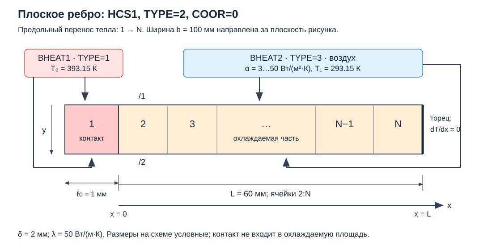
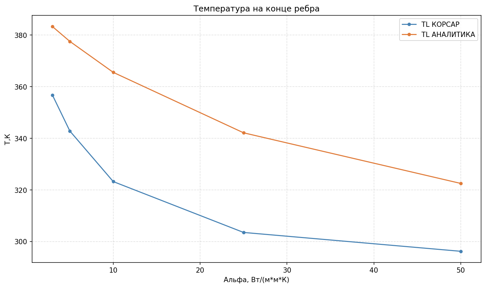
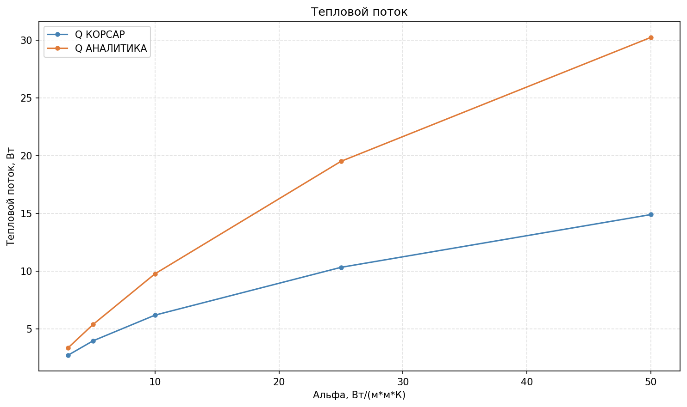

# Лабораторная работа №9. Стационарная теплопроводность в плоском ребре

## 1. Цель работы

Собрать в КОРСАР расчетную схему для моделирования прямоугольного плоского ребра с температурой основания $T_0$, охлаждаемого воздухом при температуре $T_1$. Найти температуру конца ребра, распределение температуры по высоте и мощность теплоотдачи. Сравнить численное решение с аналитическим.

### Навыки, приобретаемые по результатам выполнения работы

- Моделирование ребра элементом с двумерной теплопроводностью (HCS, TYPE=2);
- Проверка теплового баланса;
- Исследование сеточной сходимости.

---

## 2. Описание постановки задачи

### 2.1. Геометрия, допущения и нодализация

Рассматривается ребро постоянной толщины $\\delta$, ширины $b$ и высоты охлаждаемой части $L$. Координата $x$ направлена **от несущей оребренной поверхности к концу ребра, от ячейки 1 к ячейке N**; координата $y$ — поперек толщины, от поверхности `/1` к `/2`. Ширина ребра перпендикулярна плоскости рисунка.

Обе широкие поверхности охлаждаемой части обмениваются теплом с воздухом при одинаковых постоянных $\\alpha$ и $T_1$. Узкие боковые кромки и торец теплоизолированы. Излучение, внутреннее энерговыделение и зависимость свойств от температуры отсутствуют. Поэтому площадь сечения $A_c = b\\delta = 2{\\cdot}10^{-4}$ м², охлаждаемый периметр $P = 2b = 0{,}2$ м, площадь теплоотдачи $A_f = PL = 0{,}012$ м². Охлаждением узких кромок в этой постановке пренебрегается.

<a id="fig-nodal"></a>



*Рисунок 1 — Продольная теплопроводность HCS и граничные условия BHEAT.*

Для моделирования ребра необходима **двумерная** модель теплопроводности: ребро задается элементом HCS с ключом `TYPE=2`, продольная (по $x$) теплопроводность включена, поперечные градиенты учитываются автоматически.

### 2.2. Исходные данные и выбор параметров


| Параметр                                          | Значение       |
|-----------------------------------------------------------|-----------------------:|
| Высота охлаждаемой части $L$        | 0.060 м               |
| Толщина $\\delta$                                  | 0.002 м               |
| Ширина $b$                                          | 0.100 м               |
| Длина контактной ячейки $\\ell_c$    | 0.001 м               |
| Теплопроводность $\\lambda$               | 50 Вт/(м·К)       |
| Плотность $\\rho$                                | 7800 кг/м³         |
| Теплоемкость $c$                              | 500 Дж/(кг·К)    |
| Температура основания $T_0$           | 120 °C = 393.15 К    |
| Температура воздуха $T_1$               | 20 °C = 293.15 К     |
| Коэффициенты теплоотдачи $\\alpha$ | 3…50 Вт/(м²·К) |


### 2.3. Математическая модель и аналитическое решение

При малом $Bi_\\delta = \\alpha\\delta/(2\\lambda)$ температура сечения почти однородна; в рассматриваемых вариантах $Bi_\\delta \\le 0{,}001$, поэтому двумерное поле HCS сравнивается с одномерным решением.

Уравнение и граничные условия для охлаждаемой части:

<a id="eq-fin"></a>

$\\lambda A_c\\dfrac{d^2T}{dx^2} - \\alpha P(T-T_1) = 0, \\qquad T(0) = T_0, \\qquad \\left.\\dfrac{dT}{dx}\\right|_{L} = 0. \\qquad (1)$

Введем $\\theta = (T-T_1)/(T_0-T_1)$, $\\xi = x/L$, $m = \\sqrt{\\alpha P/(\\lambda A_c)} = \\sqrt{2\\alpha/(\\lambda\\delta)}$, $M = mL$. Решение для теплоизолированного торца и мощность теплоотдачи (Holman [[2]](#ref-holman); открытый вывод — MIT [[3]](#ref-mit)):

<a id="eq-profile"></a>

$\\theta(\\xi) = \\dfrac{\\cosh[M(1-\\xi)]}{\\cosh M}, \\qquad T(L) = T_1 + \\dfrac{T_0-T_1}{\\cosh M}. \\qquad (2)$

<a id="eq-power"></a>

$\\dot Q = -\\lambda A_cT'(0) = \\lambda A_cm(T_0-T_1)\\tanh M = \\alpha\\int_0^L P[T(x)-T_1]dx. \\qquad (3)$

<a id="eq-efficiency"></a>

$\\eta_f = \\dfrac{\\dot Q}{\\alpha A_f(T_0-T_1)} = \\dfrac{\\tanh M}{M}. \\qquad (4)$

Эффективность $\\eta_f$ — отношение мощности ребра к мощности изотермического ребра той же площади при $T_0$, т. е. отношение средней относительной температуры ребра к температуре его основания. Аналитическое решение приводится также в учебнике Михеева [[4]](#ref-miheev), разд. 10-6.

---

## 3. Требуемые результаты

- Нодализация задачи, постановка, исходные данные;
- Профили температуры по высоте, мощности подвода и теплоотдачи, проверка баланса;
- Зависимость эффективности от $\\alpha$;
- Скрипты обработки, расчета аналитики и отклонений; сводные таблицы сходимости;
- Вывод о достаточном разбиении, точности представления контакта и границах одномерного приближения.

---

## 4. Ход выполнения работы

Для выполнения задачи были созданы файлы задачи `kordat` и обработки данных `kutdat` для всех расчетных вариантов. Нодализация задачи представлена на рисунке [1](#fig-nodal).

Схема собрана следующим образом:

- ребро задано элементом **HCS** с `TYPE=2` (двумерная теплопроводность): $N$ ячеек по высоте ($x$, ключи `N`, `XL`), $K$ ячеек по толщине ($y$); продольная теплопроводность включена, направление от несущей оребренной поверхности к концу ребра совпадает с осью $x$;
- **ячейка 1** — контактная, длина $\\ell_c = 0{,}001$ м: задана температура границ ячейки $T_0 = 393{,}15$ К;
- **ячейки 2…N** — охлаждаемые: на поверхностях `/1` и `/2` задано граничное условие BHEAT с коэффициентами теплоотдачи $\\alpha = 3$…50 Вт/(м²·К) и температурой воздуха $T_1 = 293{,}15$ К; торец и узкие кромки — адиабатические.

В качестве начальных условий принималось равномерное поле $T = T_0$ во всех ячейках. Для вывода расчетной схемы в стационарный режим расчет выполнялся до времени $t = 5000$ с, что превышает ориентир установления стационарности $10L^2/a \\approx 2808$ с, где температуропроводность $a = \\lambda/(\\rho c) = 1{,}28\\cdot10^{-5}$ м²/с. Вывод расчетных значений (температур ячеек и тепловых потоков) осуществляется с периодичностью 5000 с, так как интерес представляют только вышедшие на статику значения параметров.

Выполнен контрольный расчет при $T_0 = T_1$: поле температуры равномерно и совпадает с $T_1$, мощность теплоотдачи равна нулю — схема собрана корректно. Проверены площади обеих сторон, выполнен расчет с выключенной продольной теплопроводностью.

Выполнены вариантные расчеты по $\\alpha$. За варианты коэффициента теплоотдачи были взяты значения: 3, 5, 10, 25, 50 Вт/(м²·К).

Построены $T(x)$ и $\\theta(\\xi)$ для всех $\\alpha$, графики $T(L)$, $\\dot Q$ и $\\eta_f$ от $\\alpha$; наложена аналитика.


*Рисунок 2 — Температурный профиль T(x) при α = 3 Вт/(м²·К).*


*Рисунок 3 — Относительный температурный профиль θ(ξ) при α = 3 Вт/(м²·К).*


*Рисунок 4 — Температурный профиль T(x) при α = 5 Вт/(м²·К).*


*Рисунок 5 — Относительный температурный профиль θ(ξ) при α = 5 Вт/(м²·К).*


*Рисунок 6 — Температурный профиль T(x) при α = 10 Вт/(м²·К).*


*Рисунок 7 — Относительный температурный профиль θ(ξ) при α = 10 Вт/(м²·К).*


*Рисунок 8 — Температурный профиль T(x) при α = 25 Вт/(м²·К).*


*Рисунок 9 — Относительный температурный профиль θ(ξ) при α = 25 Вт/(м²·К).*


*Рисунок 10 — Температурный профиль T(x) при α = 50 Вт/(м²·К).*


*Рисунок 11 — Относительный температурный профиль θ(ξ) при α = 50 Вт/(м²·К).*



*Рисунок 12 — Температура конца ребра T(L) в зависимости от α (численно и аналитически).*



*Рисунок 13 — Мощность теплоотдачи Q̇ в зависимости от α (численно и аналитически).*


*Рисунок 14 — Эффективность ребра η_f в зависимости от α (численно и аналитически).*

Для $\\alpha = 3$ и 50 выполнены расчеты на сетках $N-1 = 5...50$ ячеек при постоянных $L$, $\\ell_c$ и $K$. Были взяты количества ячеек: 5, 10, 20, 30, 40, 50. Затем было проверено $K = 3, 5, 7$ при фиксированной продольной сетке. Было произведено сравнение разности температур середины толщины и поверхностей.

**Сходимость по числу ячеек по высоте, α = 3:**


*Рисунок 15 — α = 3, N-1 = 5.*


*Рисунок 16 — α = 3, N-1 = 10.*


*Рисунок 17 — α = 3, N-1 = 30.*


*Рисунок 18 — α = 3, N-1 = 40.*


*Рисунок 19 — α = 3, N-1 = 50.*

**Сходимость по числу ячеек по высоте, α = 50:**


*Рисунок 20 — α = 50, N-1 = 5.*


*Рисунок 21 — α = 50, N-1 = 10.*


*Рисунок 22 — α = 50, N-1 = 30.*


*Рисунок 23 — α = 50, N-1 = 40.*


*Рисунок 24 — α = 50, N-1 = 50.*

**Влияние числа ячеек по толщине K (при фиксированной продольной сетке):**


*Рисунок 25 — α = 3, K = 3.*


*Рисунок 26 — α = 3, K = 7.*


*Рисунок 27 — α = 50, K = 3.*


*Рисунок 28 — α = 50, K = 7.*

Был произведен самый подробный расчет для $\\alpha = 50$ при количестве ячеек по длине 50 и по толщине 7.

---

## 5. Получение результатов работы

Для получения результатов необходимо:

- выполнить запуск кода КОРСАР при помощи команды

```cmd
START.bat
```

- после окончания расчета выполнить процессинг бинарного файла результатов расчета <u>korres</u> при помощи команды

```cmd
PROC.bat
```

- выполнить обработку результатов (portable-приложение Python): построение профилей $T(x)$ и $\\theta(\\xi)$, графиков $T(L)$, $\\dot Q$ и $\\eta_f$ от $\\alpha$ с наложением аналитики, расчет отклонений и сводные таблицы сходимости.

> На данный момент батники не работают, исправим в следующей версии. 
---

## 6. Валидация результатов расчета

```
в разработке
```

---

## 7. Список литературы

1. <a id="ref-korsar"></a> **КОРСАР/В3. Руководство пользователя.** §2.3.16, с. 71–89: HCS, продольная теплопроводность, ключи TYPE, DFZ, B, TAV; §2.3.20, с. 96–98: BHEAT.
2. <a id="ref-holman"></a> **Holman J. P.** Heat Transfer. — 10th ed. — McGraw-Hill, 2010. — Гл. 2, раздел *Extended Surfaces*: прямое ребро постоянного сечения, теплоизолированный торец и эффективность.
3. <a id="ref-mit"></a> **MIT.** Thermodynamics and Propulsion. §18.2 Heat Transfer From a Fin. — Уравнения (18.8), (18.11), (18.13): уравнение ребра, профиль и мощность при теплоизолированном торце.
4. <a id="ref-miheev"></a> **Михеев, М. А.** Основы теплопередачи / М. А. Михеев, И. М. Михеева. — Изд. 2-е, стереотип. — Москва : Энергия, 1977. — 344 с. : ил.


## 8. Сокращения и обозначения

HCS — теплопроводящая конструкция; BHEAT — заданное граничное условие; $L$ — высота охлаждаемой части, м; $\\ell_c$ — длина контактной ячейки, м; $\\delta$ — толщина, м; $b$ — ширина, м; $x$ — координата по высоте, м; $y$ — координата по толщине, м; $\\lambda$ — теплопроводность, Вт/(м·К); $\\alpha$ — коэффициент теплоотдачи, Вт/(м²·К); $T_0$, $T_1$ — температуры основания и воздуха; $A_c$ — площадь сечения, м²; $A_f$ — охлаждаемая площадь, м²; $P$ — охлаждаемый периметр, м; $\\dot Q$ — мощность, Вт; $\\eta_f$ — эффективность ребра; $M = mL$ — безразмерный параметр ребра; $Bi_\\delta = \\alpha\\delta/(2\\lambda)$ — число Био по толщине; th — гиперболический тангенс.

 
