# Лабораторная работа № 9. Стационарная теплопроводность в плоском ребре


## 1. Цель работы

Собрать в КОРСАР расчетную схему для моделирования прямоугольного плоского ребра с температурой основания <picture><source media="(prefers-color-scheme: dark)" srcset="./pic/formulas/inline-e14cb192aabe-dark.svg"></picture>, охлаждаемого воздухом при температуре <picture><source media="(prefers-color-scheme: dark)" srcset="./pic/formulas/inline-9bbeb7d12eb0-dark.svg"></picture>. Найти температуру конца ребра, распределение температуры по высоте и мощность теплоотдачи. Сравнить численное решение с аналитическим.

### Навыки, приобретаемые по результатам выполнения работы

- Моделирование ребра элементом с двумерной теплопроводностью (HCS, TYPE=2);
- Проверка теплового баланса;
- Исследование сеточной сходимости.

---

## 2. Описание постановки задачи

### 2.1. Геометрия, допущения и нодализация

Рассматривается ребро постоянной толщины <picture><source media="(prefers-color-scheme: dark)" srcset="./pic/formulas/inline-d203ba01eef4-dark.svg"></picture>, ширины <picture><source media="(prefers-color-scheme: dark)" srcset="./pic/formulas/inline-3e23e8160039-dark.svg"></picture> и высоты охлаждаемой части <picture><source media="(prefers-color-scheme: dark)" srcset="./pic/formulas/inline-72dfcfb0c470-dark.svg"></picture>. Координата <picture><source media="(prefers-color-scheme: dark)" srcset="./pic/formulas/inline-2d711642b726-dark.svg"></picture> направлена **от несущей оребренной поверхности к концу ребра, от ячейки 1 к ячейке N**; координата <picture><source media="(prefers-color-scheme: dark)" srcset="./pic/formulas/inline-a1fce4363854-dark.svg"></picture> — поперек толщины, от поверхности `/1` к `/2`. Ширина ребра перпендикулярна плоскости рисунка.

Обе широкие поверхности охлаждаемой части обмениваются теплом с воздухом при одинаковых постоянных <picture><source media="(prefers-color-scheme: dark)" srcset="./pic/formulas/inline-4893e9df8b54-dark.svg"></picture> и <picture><source media="(prefers-color-scheme: dark)" srcset="./pic/formulas/inline-9bbeb7d12eb0-dark.svg"></picture>. Узкие боковые кромки и торец теплоизолированы. Излучение, внутреннее энерговыделение и зависимость свойств от температуры отсутствуют. Поэтому площадь сечения <picture><source media="(prefers-color-scheme: dark)" srcset="./pic/formulas/inline-75115b4c6738-dark.svg"></picture> м², охлаждаемый периметр <picture><source media="(prefers-color-scheme: dark)" srcset="./pic/formulas/inline-58e6b3afc070-dark.svg"></picture> м, площадь теплоотдачи <picture><source media="(prefers-color-scheme: dark)" srcset="./pic/formulas/inline-190b8b226c33-dark.svg"></picture> м². Охлаждением узких кромок в этой постановке пренебрегается.

<a id="fig-nodal"></a>


*Рисунок 1 — Продольная теплопроводность HCS и граничные условия BHEAT.*

Для моделирования ребра необходима **двумерная** модель теплопроводности: ребро задается элементом HCS с ключом `TYPE=2`, продольная (по <picture><source media="(prefers-color-scheme: dark)" srcset="./pic/formulas/inline-2d711642b726-dark.svg"></picture>) теплопроводность включена, поперечные градиенты учитываются автоматически.

### 2.2. Исходные данные и выбор параметров


| Параметр                                          | Значение       |
|-----------------------------------------------------------|-----------------------:|
| Высота охлаждаемой части <picture><source media="(prefers-color-scheme: dark)" srcset="./pic/formulas/inline-72dfcfb0c470-dark.svg"></picture>        | 0.060 м               |
| Толщина <picture><source media="(prefers-color-scheme: dark)" srcset="./pic/formulas/inline-d203ba01eef4-dark.svg"></picture>                                  | 0.002 м               |
| Ширина <picture><source media="(prefers-color-scheme: dark)" srcset="./pic/formulas/inline-3e23e8160039-dark.svg"></picture>                                          | 0.100 м               |
| Длина контактной ячейки <picture><source media="(prefers-color-scheme: dark)" srcset="./pic/formulas/inline-e5916cb731c6-dark.svg"></picture>    | 0.001 м               |
| Теплопроводность <picture><source media="(prefers-color-scheme: dark)" srcset="./pic/formulas/inline-583cf6290785-dark.svg"></picture>               | 50 Вт/(м·К)       |
| Плотность <picture><source media="(prefers-color-scheme: dark)" srcset="./pic/formulas/inline-dabec2cdc19c-dark.svg"></picture>                                | 7800 кг/м³         |
| Теплоемкость <picture><source media="(prefers-color-scheme: dark)" srcset="./pic/formulas/inline-2e7d2c03a950-dark.svg"></picture>                              | 500 Дж/(кг·К)    |
| Температура основания <picture><source media="(prefers-color-scheme: dark)" srcset="./pic/formulas/inline-e14cb192aabe-dark.svg"></picture>           | 120 °C = 393.15 К    |
| Температура воздуха <picture><source media="(prefers-color-scheme: dark)" srcset="./pic/formulas/inline-9bbeb7d12eb0-dark.svg"></picture>               | 20 °C = 293.15 К     |
| Коэффициенты теплоотдачи <picture><source media="(prefers-color-scheme: dark)" srcset="./pic/formulas/inline-4893e9df8b54-dark.svg"></picture> | 3…50 Вт/(м²·К) |


### 2.3. Математическая модель и аналитическое решение

При малом <picture><source media="(prefers-color-scheme: dark)" srcset="./pic/formulas/inline-b85ee422228e-dark.svg"></picture> температура сечения почти однородна; в рассматриваемых вариантах <picture><source media="(prefers-color-scheme: dark)" srcset="./pic/formulas/inline-80205b80aed7-dark.svg"></picture>, поэтому двумерное поле HCS сравнивается с одномерным решением.

Уравнение и граничные условия для охлаждаемой части:

<a id="eq-fin"></a>


<picture><source media="(prefers-color-scheme: dark)" srcset="./pic/formulas/equation-aafa0b0a3aec-dark.svg"></picture>


Введем <picture><source media="(prefers-color-scheme: dark)" srcset="./pic/formulas/inline-5c3af7d34eae-dark.svg"></picture>, <picture><source media="(prefers-color-scheme: dark)" srcset="./pic/formulas/inline-0c655446d538-dark.svg"></picture>, <picture><source media="(prefers-color-scheme: dark)" srcset="./pic/formulas/inline-5655b3f1c627-dark.svg"></picture>, <picture><source media="(prefers-color-scheme: dark)" srcset="./pic/formulas/inline-19f219da7a17-dark.svg"></picture>. Решение для теплоизолированного торца и мощность теплоотдачи (Holman [[2]](#ref-holman); открытый вывод — MIT [[3]](#ref-mit)):

<a id="eq-profile"></a>


<picture><source media="(prefers-color-scheme: dark)" srcset="./pic/formulas/equation-c06814c34b63-dark.svg"></picture>


<a id="eq-power"></a>


<picture><source media="(prefers-color-scheme: dark)" srcset="./pic/formulas/equation-641abcf1c840-dark.svg"></picture>


<a id="eq-efficiency"></a>


<picture><source media="(prefers-color-scheme: dark)" srcset="./pic/formulas/equation-1af6d3fdad48-dark.svg"></picture>


Эффективность <picture><source media="(prefers-color-scheme: dark)" srcset="./pic/formulas/inline-c85cee5084c7-dark.svg"></picture> — отношение мощности ребра к мощности изотермического ребра той же площади при <picture><source media="(prefers-color-scheme: dark)" srcset="./pic/formulas/inline-e14cb192aabe-dark.svg"></picture>, т. е. отношение средней относительной температуры ребра к температуре его основания. Аналитическое решение приводится также в учебнике Михеева [[4]](#ref-miheev), разд. 10-6.

---

## 3. Требуемые результаты

- Нодализация задачи, постановка, исходные данные;
- Профили температуры по высоте, мощности подвода и теплоотдачи, проверка баланса;
- Зависимость эффективности от <picture><source media="(prefers-color-scheme: dark)" srcset="./pic/formulas/inline-4893e9df8b54-dark.svg"></picture>;
- Скрипты обработки, расчета аналитики и отклонений; сводные таблицы сходимости;
- Вывод о достаточном разбиении, точности представления контакта и границах одномерного приближения.

---

## 4. Ход выполнения работы

Для выполнения задачи были созданы файлы задачи `kordat` и обработки данных `kutdat` для всех расчетных вариантов. Нодализация задачи представлена на рисунке [1](#fig-nodal).

Схема собрана следующим образом:

- ребро задано элементом **HCS** с `TYPE=2` (двумерная теплопроводность): <picture><source media="(prefers-color-scheme: dark)" srcset="./pic/formulas/inline-8ce86a6ae65d-dark.svg"></picture> ячеек по высоте (<picture><source media="(prefers-color-scheme: dark)" srcset="./pic/formulas/inline-2d711642b726-dark.svg"></picture>, ключи `N`, `XL`), <picture><source media="(prefers-color-scheme: dark)" srcset="./pic/formulas/inline-86be9a55762d-dark.svg"></picture> ячеек по толщине (<picture><source media="(prefers-color-scheme: dark)" srcset="./pic/formulas/inline-a1fce4363854-dark.svg"></picture>); продольная теплопроводность включена, направление от несущей оребренной поверхности к концу ребра совпадает с осью <picture><source media="(prefers-color-scheme: dark)" srcset="./pic/formulas/inline-2d711642b726-dark.svg"></picture>;
- **ячейка 1** — контактная, длина <picture><source media="(prefers-color-scheme: dark)" srcset="./pic/formulas/inline-bfa27e335e3e-dark.svg"></picture> м: задана температура границ ячейки <picture><source media="(prefers-color-scheme: dark)" srcset="./pic/formulas/inline-a32255d13ee3-dark.svg"></picture> К;
- **ячейки 2…N** — охлаждаемые: на поверхностях `/1` и `/2` задано граничное условие BHEAT с коэффициентами теплоотдачи <picture><source media="(prefers-color-scheme: dark)" srcset="./pic/formulas/inline-59c28bf970ce-dark.svg"></picture> Вт/(м²·К) и температурой воздуха <picture><source media="(prefers-color-scheme: dark)" srcset="./pic/formulas/inline-0d2363524ac8-dark.svg"></picture> К; торец и узкие кромки — адиабатические.

В качестве начальных условий принималось равномерное поле <picture><source media="(prefers-color-scheme: dark)" srcset="./pic/formulas/inline-526833ee7145-dark.svg"></picture> во всех ячейках. Для вывода расчетной схемы в стационарный режим расчет выполнялся до времени <picture><source media="(prefers-color-scheme: dark)" srcset="./pic/formulas/inline-e87b53fb439a-dark.svg"></picture> с, что превышает ориентир установления стационарности <picture><source media="(prefers-color-scheme: dark)" srcset="./pic/formulas/inline-7f57202da228-dark.svg"></picture> с, где температуропроводность <picture><source media="(prefers-color-scheme: dark)" srcset="./pic/formulas/inline-712725ba29a5-dark.svg"></picture> м²/с. Вывод расчетных значений (температур ячеек и тепловых потоков) осуществляется с периодичностью 5000 с, так как интерес представляют только вышедшие на статику значения параметров.

Выполнен контрольный расчет при <picture><source media="(prefers-color-scheme: dark)" srcset="./pic/formulas/inline-0ddf590cd206-dark.svg"></picture>: поле температуры равномерно и совпадает с <picture><source media="(prefers-color-scheme: dark)" srcset="./pic/formulas/inline-9bbeb7d12eb0-dark.svg"></picture>, мощность теплоотдачи равна нулю — схема собрана корректно. Проверены площади обеих сторон, выполнен расчет с выключенной продольной теплопроводностью.

Выполнены вариантные расчеты по <picture><source media="(prefers-color-scheme: dark)" srcset="./pic/formulas/inline-4893e9df8b54-dark.svg"></picture>. За варианты коэффициента теплоотдачи были взяты значения: 3, 5, 10, 25, 50 Вт/(м²·К).

Построены <picture><source media="(prefers-color-scheme: dark)" srcset="./pic/formulas/inline-1165c59bb905-dark.svg"></picture> и <picture><source media="(prefers-color-scheme: dark)" srcset="./pic/formulas/inline-7695d2a56e69-dark.svg"></picture> для всех <picture><source media="(prefers-color-scheme: dark)" srcset="./pic/formulas/inline-4893e9df8b54-dark.svg"></picture>, графики <picture><source media="(prefers-color-scheme: dark)" srcset="./pic/formulas/inline-7b02c5fbbc7e-dark.svg"></picture>, <picture><source media="(prefers-color-scheme: dark)" srcset="./pic/formulas/inline-4065187ab116-dark.svg"></picture> и <picture><source media="(prefers-color-scheme: dark)" srcset="./pic/formulas/inline-c85cee5084c7-dark.svg"></picture> от <picture><source media="(prefers-color-scheme: dark)" srcset="./pic/formulas/inline-4893e9df8b54-dark.svg"></picture>; наложена аналитика.

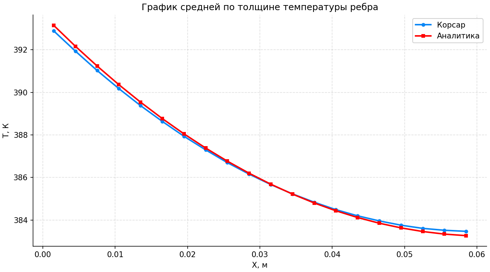

*Рисунок 2 — Температурный профиль <picture><source media="(prefers-color-scheme: dark)" srcset="./pic/formulas/inline-1165c59bb905-dark.svg"></picture> при <picture><source media="(prefers-color-scheme: dark)" srcset="./pic/formulas/inline-76fe4fec6c0a-dark.svg"></picture> Вт/(м²·К).*

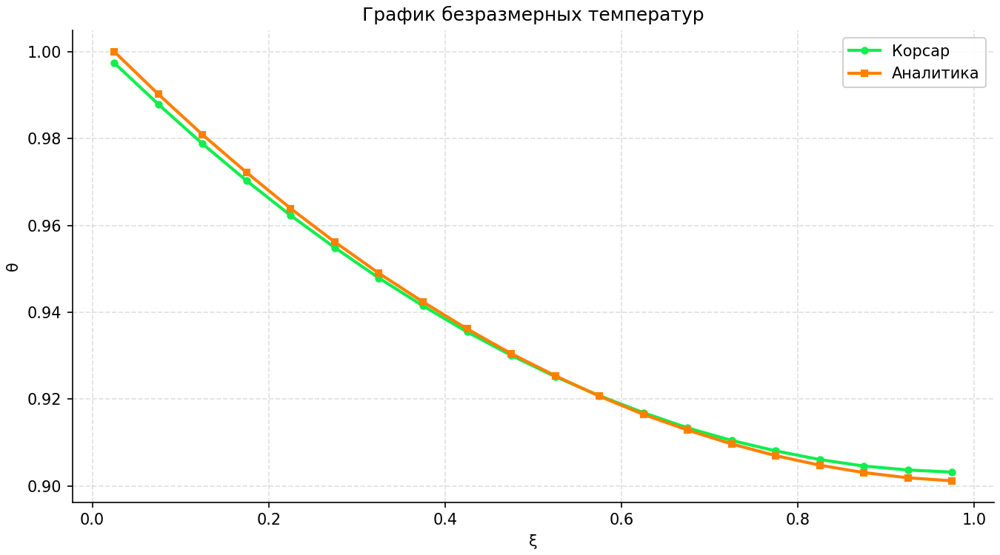

*Рисунок 3 — Относительный температурный профиль <picture><source media="(prefers-color-scheme: dark)" srcset="./pic/formulas/inline-7695d2a56e69-dark.svg"></picture> при <picture><source media="(prefers-color-scheme: dark)" srcset="./pic/formulas/inline-76fe4fec6c0a-dark.svg"></picture> Вт/(м²·К).*

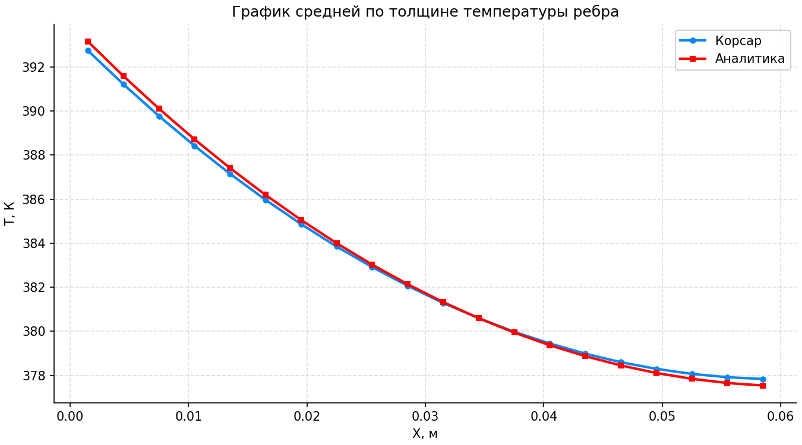

*Рисунок 4 — Температурный профиль <picture><source media="(prefers-color-scheme: dark)" srcset="./pic/formulas/inline-1165c59bb905-dark.svg"></picture> при <picture><source media="(prefers-color-scheme: dark)" srcset="./pic/formulas/inline-11fdec7448c8-dark.svg"></picture> Вт/(м²·К).*

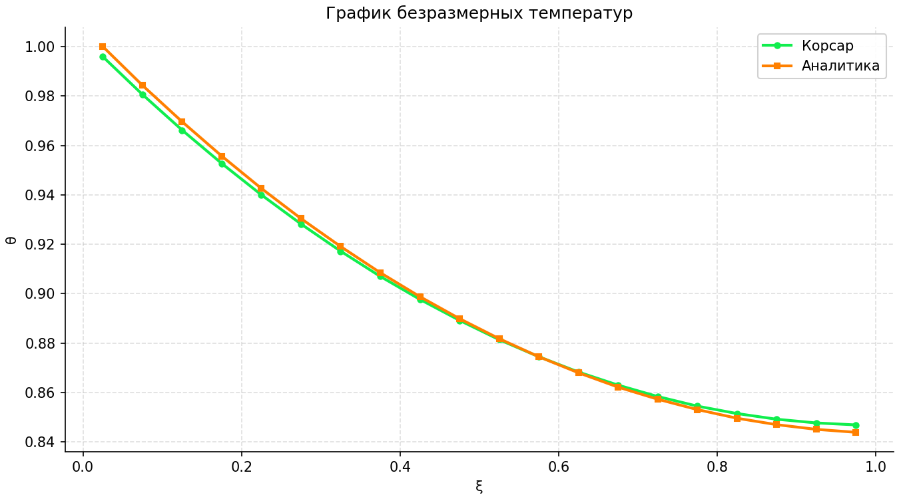

*Рисунок 5 — Относительный температурный профиль <picture><source media="(prefers-color-scheme: dark)" srcset="./pic/formulas/inline-7695d2a56e69-dark.svg"></picture> при <picture><source media="(prefers-color-scheme: dark)" srcset="./pic/formulas/inline-11fdec7448c8-dark.svg"></picture> Вт/(м²·К).*

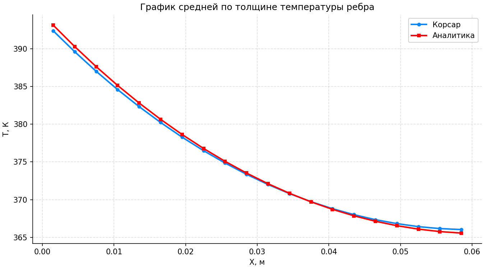

*Рисунок 6 — Температурный профиль <picture><source media="(prefers-color-scheme: dark)" srcset="./pic/formulas/inline-1165c59bb905-dark.svg"></picture> при <picture><source media="(prefers-color-scheme: dark)" srcset="./pic/formulas/inline-e0bcac71b4a3-dark.svg"></picture> Вт/(м²·К).*

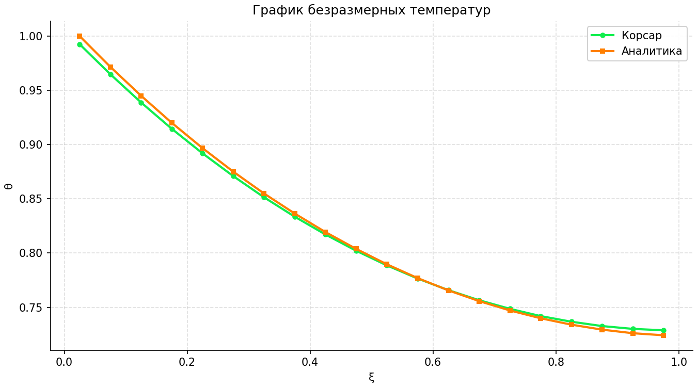

*Рисунок 7 — Относительный температурный профиль <picture><source media="(prefers-color-scheme: dark)" srcset="./pic/formulas/inline-7695d2a56e69-dark.svg"></picture> при <picture><source media="(prefers-color-scheme: dark)" srcset="./pic/formulas/inline-e0bcac71b4a3-dark.svg"></picture> Вт/(м²·К).*

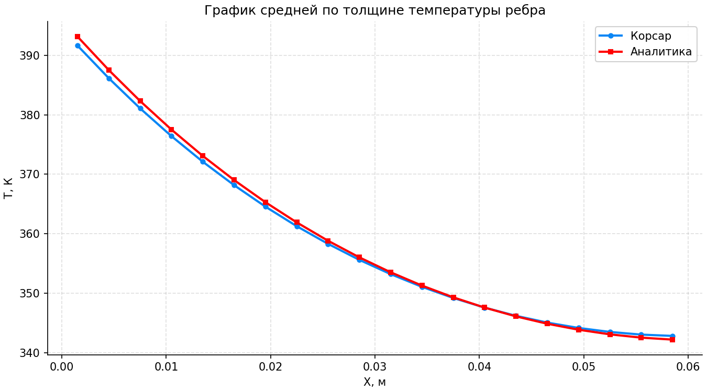

*Рисунок 8 — Температурный профиль <picture><source media="(prefers-color-scheme: dark)" srcset="./pic/formulas/inline-1165c59bb905-dark.svg"></picture> при <picture><source media="(prefers-color-scheme: dark)" srcset="./pic/formulas/inline-08ffccf37974-dark.svg"></picture> Вт/(м²·К).*

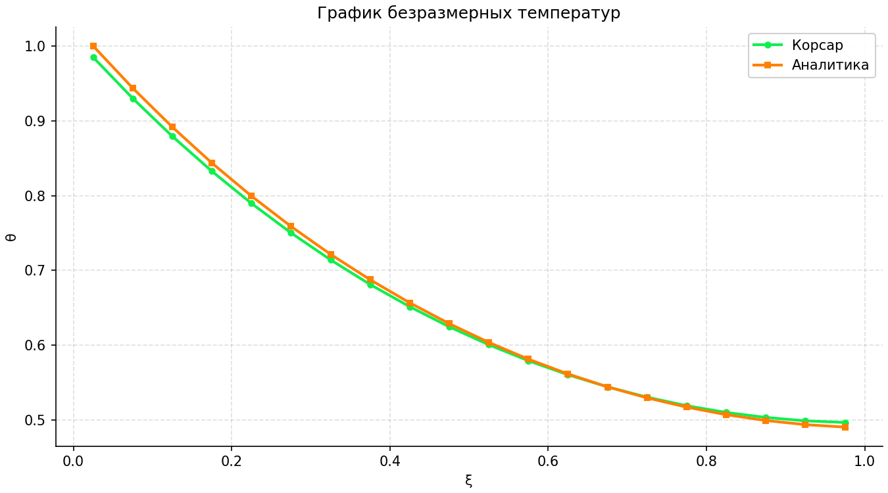

*Рисунок 9 — Относительный температурный профиль <picture><source media="(prefers-color-scheme: dark)" srcset="./pic/formulas/inline-7695d2a56e69-dark.svg"></picture> при <picture><source media="(prefers-color-scheme: dark)" srcset="./pic/formulas/inline-08ffccf37974-dark.svg"></picture> Вт/(м²·К).*

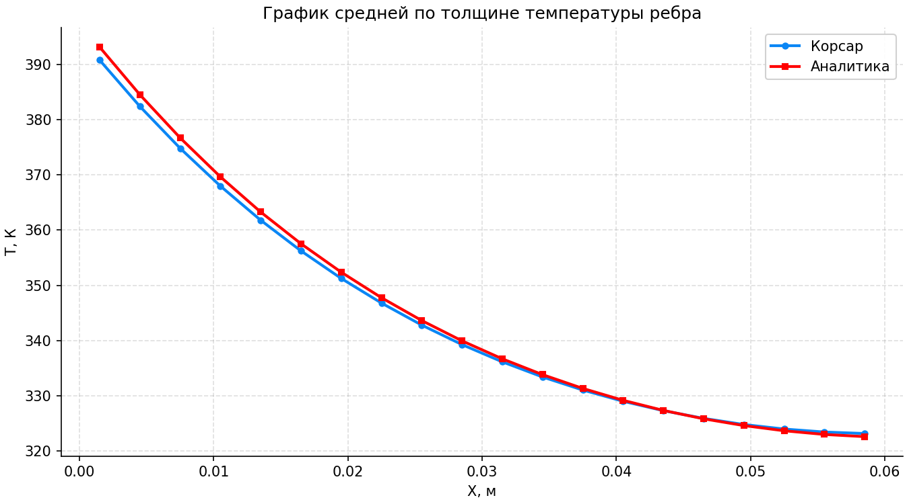

*Рисунок 10 — Температурный профиль <picture><source media="(prefers-color-scheme: dark)" srcset="./pic/formulas/inline-1165c59bb905-dark.svg"></picture> при <picture><source media="(prefers-color-scheme: dark)" srcset="./pic/formulas/inline-1c74e5eaafa3-dark.svg"></picture> Вт/(м²·К).*


*Рисунок 11 — Относительный температурный профиль <picture><source media="(prefers-color-scheme: dark)" srcset="./pic/formulas/inline-7695d2a56e69-dark.svg"></picture> при <picture><source media="(prefers-color-scheme: dark)" srcset="./pic/formulas/inline-1c74e5eaafa3-dark.svg"></picture> Вт/(м²·К).*

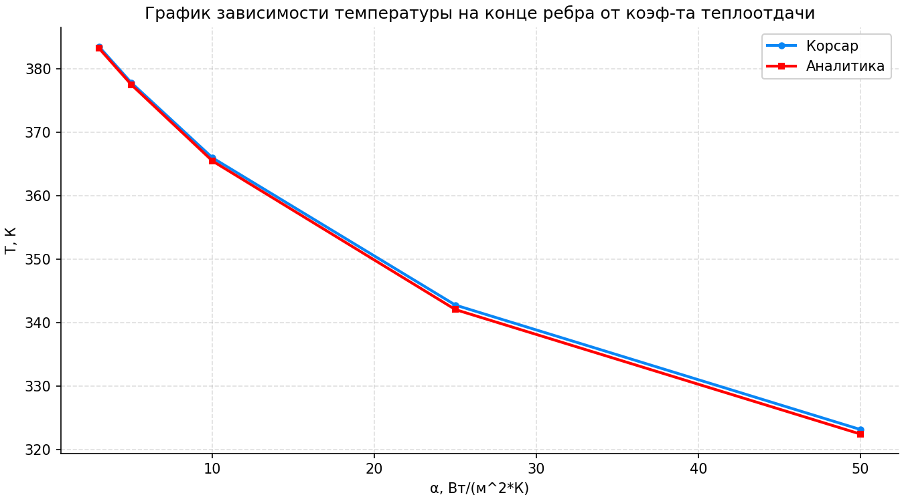

*Рисунок 12 — Температура конца ребра <picture><source media="(prefers-color-scheme: dark)" srcset="./pic/formulas/inline-7b02c5fbbc7e-dark.svg"></picture> в зависимости от α (численно и аналитически).*

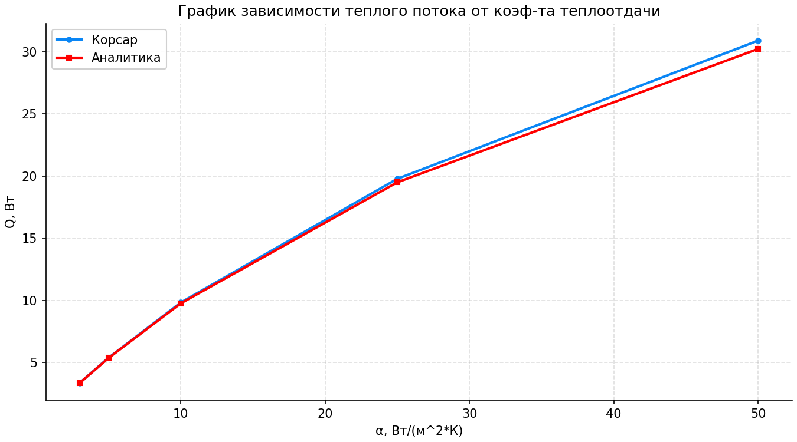

*Рисунок 13 — Мощность теплоотдачи <picture><source media="(prefers-color-scheme: dark)" srcset="./pic/formulas/inline-4065187ab116-dark.svg"></picture> в зависимости от α (численно и аналитически).*

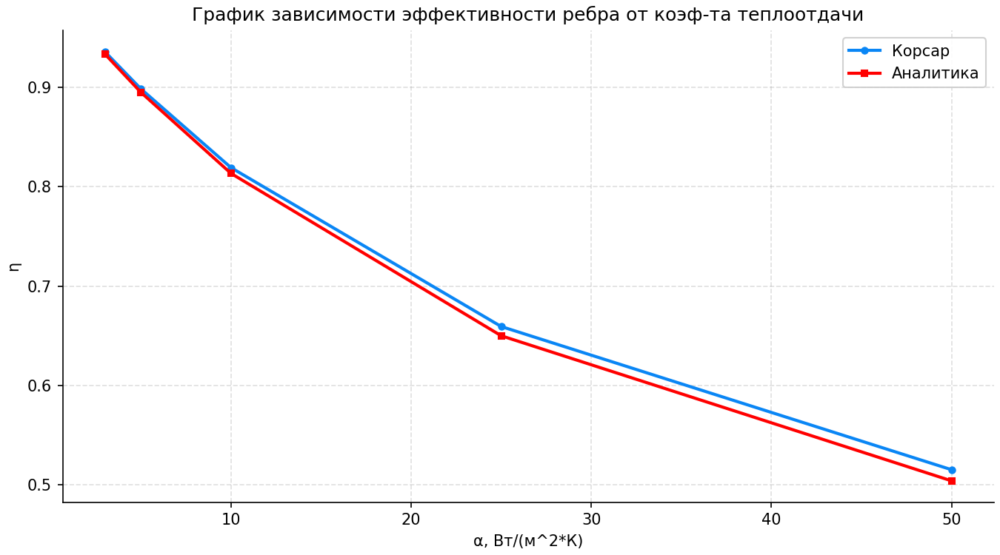

*Рисунок 14 — Эффективность ребра <picture><source media="(prefers-color-scheme: dark)" srcset="./pic/formulas/inline-c85cee5084c7-dark.svg"></picture> в зависимости от α (численно и аналитически).*

Для <picture><source media="(prefers-color-scheme: dark)" srcset="./pic/formulas/inline-76fe4fec6c0a-dark.svg"></picture> и 50 выполнены расчеты на сетках <picture><source media="(prefers-color-scheme: dark)" srcset="./pic/formulas/inline-da5502ebce3e-dark.svg"></picture> ячеек при постоянных <picture><source media="(prefers-color-scheme: dark)" srcset="./pic/formulas/inline-72dfcfb0c470-dark.svg"></picture>, <picture><source media="(prefers-color-scheme: dark)" srcset="./pic/formulas/inline-e5916cb731c6-dark.svg"></picture> и <picture><source media="(prefers-color-scheme: dark)" srcset="./pic/formulas/inline-86be9a55762d-dark.svg"></picture>. Были взяты количества ячеек: 5, 10, 20, 30, 40, 50. Затем было проверено <picture><source media="(prefers-color-scheme: dark)" srcset="./pic/formulas/inline-fc026a95db6e-dark.svg"></picture> при фиксированной продольной сетке. Было произведено сравнение разности температур середины толщины и поверхностей.

**Сходимость по числу ячеек по высоте, <picture><source media="(prefers-color-scheme: dark)" srcset="./pic/formulas/inline-76fe4fec6c0a-dark.svg"></picture>:**

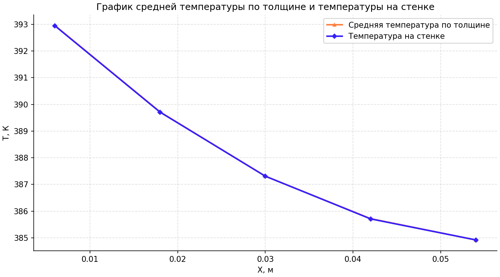

*Рисунок 15 — <picture><source media="(prefers-color-scheme: dark)" srcset="./pic/formulas/inline-76fe4fec6c0a-dark.svg"></picture>, <picture><source media="(prefers-color-scheme: dark)" srcset="./pic/formulas/inline-914688053611-dark.svg"></picture>.*

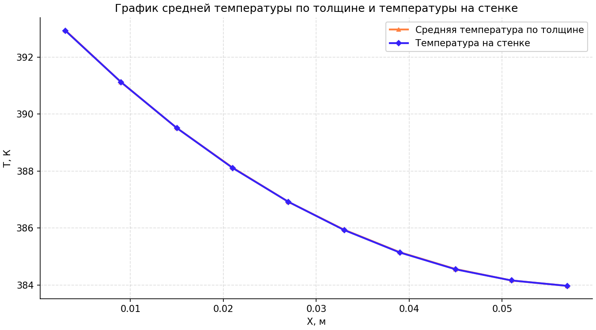

*Рисунок 16 — <picture><source media="(prefers-color-scheme: dark)" srcset="./pic/formulas/inline-76fe4fec6c0a-dark.svg"></picture>, <picture><source media="(prefers-color-scheme: dark)" srcset="./pic/formulas/inline-352d0db1e232-dark.svg"></picture>.*


*Рисунок 17 — <picture><source media="(prefers-color-scheme: dark)" srcset="./pic/formulas/inline-76fe4fec6c0a-dark.svg"></picture>, <picture><source media="(prefers-color-scheme: dark)" srcset="./pic/formulas/inline-41cf6b25fd26-dark.svg"></picture>.*

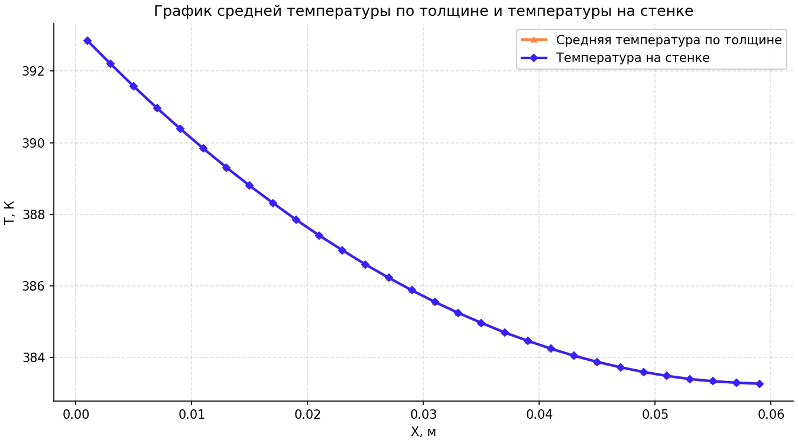

*Рисунок 18 — <picture><source media="(prefers-color-scheme: dark)" srcset="./pic/formulas/inline-76fe4fec6c0a-dark.svg"></picture>, <picture><source media="(prefers-color-scheme: dark)" srcset="./pic/formulas/inline-a53e5a3590a5-dark.svg"></picture>.*


*Рисунок 19 — <picture><source media="(prefers-color-scheme: dark)" srcset="./pic/formulas/inline-76fe4fec6c0a-dark.svg"></picture>, <picture><source media="(prefers-color-scheme: dark)" srcset="./pic/formulas/inline-8dc0a0ebb28d-dark.svg"></picture>.*

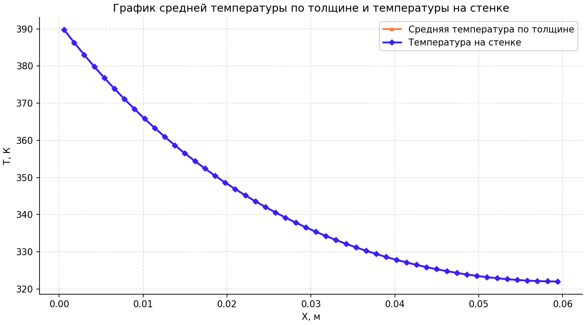

*Рисунок 20 — <picture><source media="(prefers-color-scheme: dark)" srcset="./pic/formulas/inline-76fe4fec6c0a-dark.svg"></picture>, <picture><source media="(prefers-color-scheme: dark)" srcset="./pic/formulas/inline-48eeef94b005-dark.svg"></picture>.*

**Сходимость по числу ячеек по высоте, <picture><source media="(prefers-color-scheme: dark)" srcset="./pic/formulas/inline-1c74e5eaafa3-dark.svg"></picture>:**

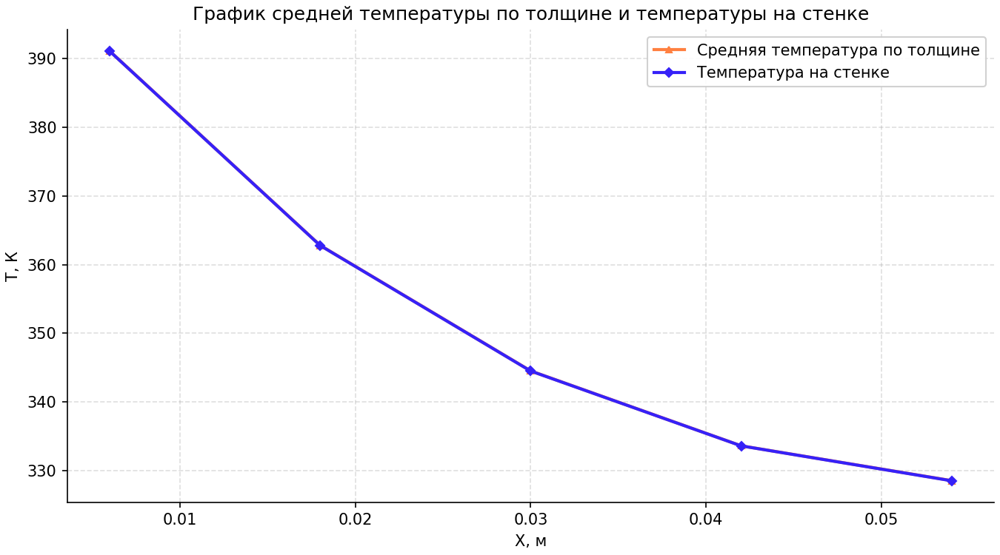

*Рисунок 21 — <picture><source media="(prefers-color-scheme: dark)" srcset="./pic/formulas/inline-1c74e5eaafa3-dark.svg"></picture>, <picture><source media="(prefers-color-scheme: dark)" srcset="./pic/formulas/inline-914688053611-dark.svg"></picture>.*

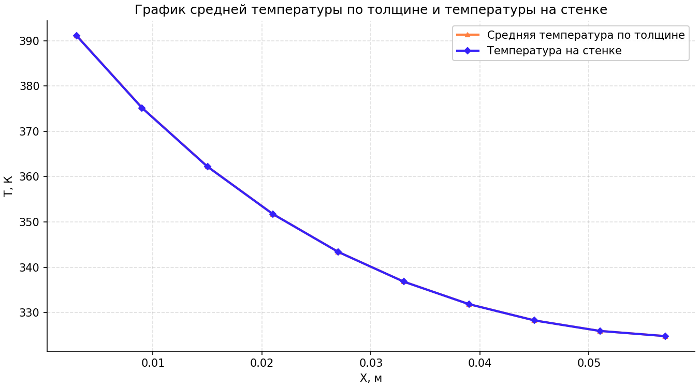

*Рисунок 22 — <picture><source media="(prefers-color-scheme: dark)" srcset="./pic/formulas/inline-1c74e5eaafa3-dark.svg"></picture>, <picture><source media="(prefers-color-scheme: dark)" srcset="./pic/formulas/inline-352d0db1e232-dark.svg"></picture>.*


*Рисунок 23 — <picture><source media="(prefers-color-scheme: dark)" srcset="./pic/formulas/inline-1c74e5eaafa3-dark.svg"></picture>, <picture><source media="(prefers-color-scheme: dark)" srcset="./pic/formulas/inline-41cf6b25fd26-dark.svg"></picture>.*

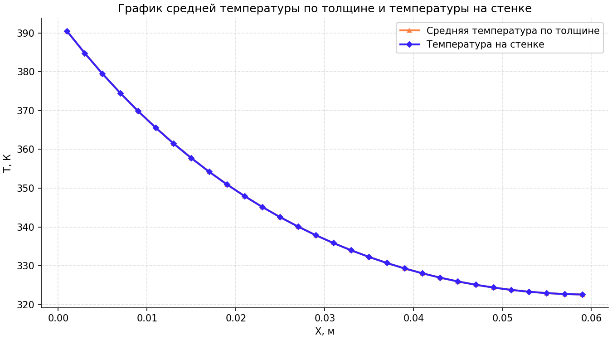

*Рисунок 24 — <picture><source media="(prefers-color-scheme: dark)" srcset="./pic/formulas/inline-1c74e5eaafa3-dark.svg"></picture>, <picture><source media="(prefers-color-scheme: dark)" srcset="./pic/formulas/inline-a53e5a3590a5-dark.svg"></picture>.*


*Рисунок 25 — <picture><source media="(prefers-color-scheme: dark)" srcset="./pic/formulas/inline-1c74e5eaafa3-dark.svg"></picture>, <picture><source media="(prefers-color-scheme: dark)" srcset="./pic/formulas/inline-8dc0a0ebb28d-dark.svg"></picture>.*


*Рисунок 26 — <picture><source media="(prefers-color-scheme: dark)" srcset="./pic/formulas/inline-1c74e5eaafa3-dark.svg"></picture>, <picture><source media="(prefers-color-scheme: dark)" srcset="./pic/formulas/inline-48eeef94b005-dark.svg"></picture>.*

**Влияние числа ячеек по толщине K (при фиксированной продольной сетке):**

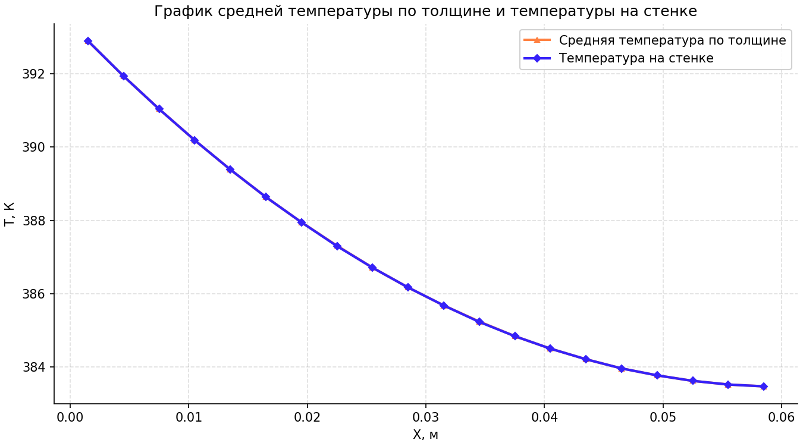

*Рисунок 27 — <picture><source media="(prefers-color-scheme: dark)" srcset="./pic/formulas/inline-76fe4fec6c0a-dark.svg"></picture>, <picture><source media="(prefers-color-scheme: dark)" srcset="./pic/formulas/inline-1de9a5b9680a-dark.svg"></picture>.*


*Рисунок 28 — <picture><source media="(prefers-color-scheme: dark)" srcset="./pic/formulas/inline-76fe4fec6c0a-dark.svg"></picture>, <picture><source media="(prefers-color-scheme: dark)" srcset="./pic/formulas/inline-c60f03e77856-dark.svg"></picture>.*

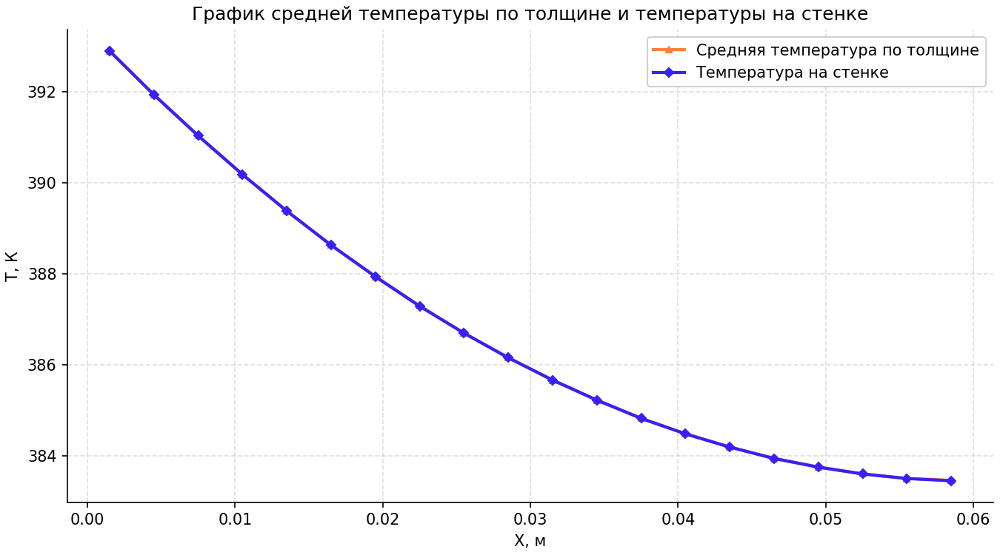

*Рисунок 29 — <picture><source media="(prefers-color-scheme: dark)" srcset="./pic/formulas/inline-76fe4fec6c0a-dark.svg"></picture>, <picture><source media="(prefers-color-scheme: dark)" srcset="./pic/formulas/inline-9e9d70da3bc8-dark.svg"></picture>.*

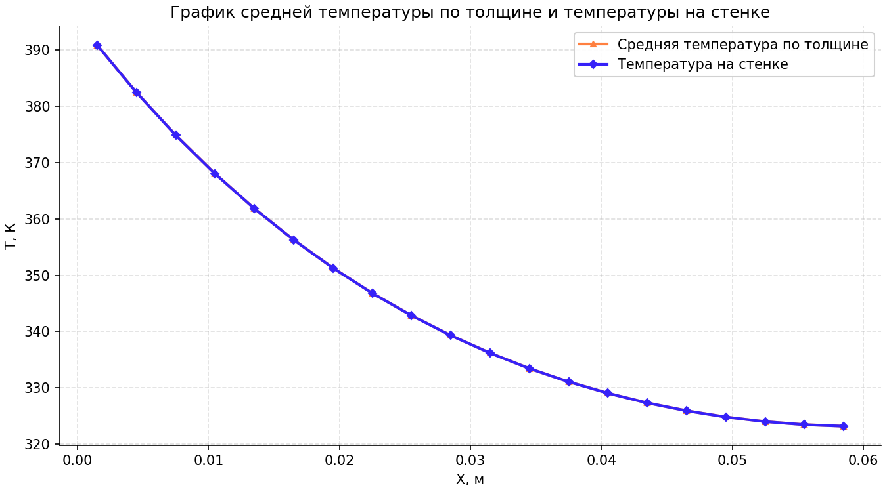

*Рисунок 30 — <picture><source media="(prefers-color-scheme: dark)" srcset="./pic/formulas/inline-1c74e5eaafa3-dark.svg"></picture>, <picture><source media="(prefers-color-scheme: dark)" srcset="./pic/formulas/inline-1de9a5b9680a-dark.svg"></picture>.*


*Рисунок 31 — <picture><source media="(prefers-color-scheme: dark)" srcset="./pic/formulas/inline-1c74e5eaafa3-dark.svg"></picture>, <picture><source media="(prefers-color-scheme: dark)" srcset="./pic/formulas/inline-c60f03e77856-dark.svg"></picture>.*


*Рисунок 32 — <picture><source media="(prefers-color-scheme: dark)" srcset="./pic/formulas/inline-1c74e5eaafa3-dark.svg"></picture>, <picture><source media="(prefers-color-scheme: dark)" srcset="./pic/formulas/inline-9e9d70da3bc8-dark.svg"></picture>.*

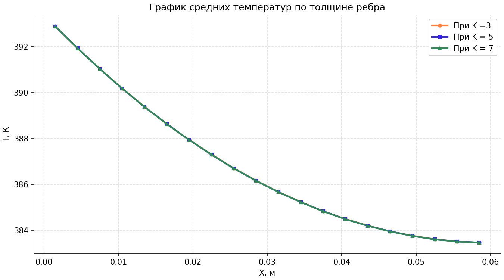

*Рисунок 33 — Сравнение результатов по K при <picture><source media="(prefers-color-scheme: dark)" srcset="./pic/formulas/inline-76fe4fec6c0a-dark.svg"></picture>.*

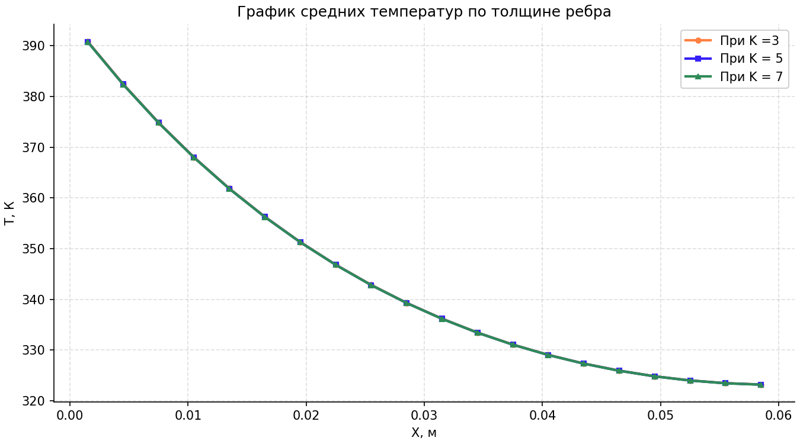

*Рисунок 34 — Сравнение результатов по K при <picture><source media="(prefers-color-scheme: dark)" srcset="./pic/formulas/inline-1c74e5eaafa3-dark.svg"></picture>.*

Был произведен самый подробный расчет для <picture><source media="(prefers-color-scheme: dark)" srcset="./pic/formulas/inline-1c74e5eaafa3-dark.svg"></picture> при количестве ячеек по длине 50 и по толщине 7.

---

## 5. Получение результатов работы

Для получения результатов необходимо:

- выполнить запуск кода КОРСАР при помощи команды

```cmd
START.bat
```

- после окончания расчета выполнить процессинг бинарного файла результатов расчета `korres` при помощи команды

```cmd
PROC.bat
```

- выполнить обработку результатов (приложение Python): построение профилей <picture><source media="(prefers-color-scheme: dark)" srcset="./pic/formulas/inline-1165c59bb905-dark.svg"></picture> и <picture><source media="(prefers-color-scheme: dark)" srcset="./pic/formulas/inline-7695d2a56e69-dark.svg"></picture>, графиков <picture><source media="(prefers-color-scheme: dark)" srcset="./pic/formulas/inline-7b02c5fbbc7e-dark.svg"></picture>, <picture><source media="(prefers-color-scheme: dark)" srcset="./pic/formulas/inline-4065187ab116-dark.svg"></picture> и <picture><source media="(prefers-color-scheme: dark)" srcset="./pic/formulas/inline-c85cee5084c7-dark.svg"></picture> от <picture><source media="(prefers-color-scheme: dark)" srcset="./pic/formulas/inline-4893e9df8b54-dark.svg"></picture> с наложением аналитики, расчет отклонений и сводные таблицы сходимости.

---

## 6. Сравнение с аналитическим решением

Для проверки результатов расчета использовалось аналитическое решение формулы (2)–(4). Полученные расчетные оценки:


| <picture><source media="(prefers-color-scheme: dark)" srcset="./pic/formulas/inline-4893e9df8b54-dark.svg"></picture>, Вт/(м²·К) | <picture><source media="(prefers-color-scheme: dark)" srcset="./pic/formulas/inline-7b02c5fbbc7e-dark.svg"></picture>, К | <picture><source media="(prefers-color-scheme: dark)" srcset="./pic/formulas/inline-4065187ab116-dark.svg"></picture>, Вт | <picture><source media="(prefers-color-scheme: dark)" srcset="./pic/formulas/inline-c85cee5084c7-dark.svg"></picture> |
|---------------------------:|-----------:|----------------:|----------:|
| 3                          | 383.2435   | 3.3614          | 0.9337    |
| 5                          | 377.5051   | 5.3705          | 0.8951    |
| 10                         | 365.5023   | 9.7623          | 0.8135    |
| 25                         | 342.0889   | 19.5            | 0.65      |
| 50                         | 322.4829   | 30.2317         | 0.5039    |


С помощью приложения [`Q_eta_calculator`](https://github.com/ArtemNarimanov/Q_eta_calculator), написанного на Python, из результатов КОРСАР получены следующие значения:


| <picture><source media="(prefers-color-scheme: dark)" srcset="./pic/formulas/inline-4893e9df8b54-dark.svg"></picture>, Вт/(м²·К) | <picture><source media="(prefers-color-scheme: dark)" srcset="./pic/formulas/inline-7b02c5fbbc7e-dark.svg"></picture>, К | <picture><source media="(prefers-color-scheme: dark)" srcset="./pic/formulas/inline-4065187ab116-dark.svg"></picture>, Вт | <picture><source media="(prefers-color-scheme: dark)" srcset="./pic/formulas/inline-c85cee5084c7-dark.svg"></picture> |
|---------------------------:|-----------:|----------------:|----------:|
| 3                          | 383.5      | 3.37            | 0.936     |
| 5                          | 377.8      | 5.391           | 0.8986    |
| 10                         | 366        | 9.831           | 0.8193    |
| 25                         | 342.8      | 19.78           | 0.6593    |
| 50                         | 323.2      | 30.9            | 0.5151    |


В SMath Solver получены отклонения данных на основе Корсара от аналитической оценки:


| <picture><source media="(prefers-color-scheme: dark)" srcset="./pic/formulas/inline-4893e9df8b54-dark.svg"></picture>, Вт/(м²·К) | <picture><source media="(prefers-color-scheme: dark)" srcset="./pic/formulas/inline-6af80f5bfd31-dark.svg"></picture>, К | <picture><source media="(prefers-color-scheme: dark)" srcset="./pic/formulas/inline-12a6885b421a-dark.svg"></picture>, Вт | <picture><source media="(prefers-color-scheme: dark)" srcset="./pic/formulas/inline-29a0844b4f58-dark.svg"></picture> |
|---------------------------:|-------------------:|-----------------------:|-----------------:|
| 3                          | 0.2565             | 0.0086                 | 0.0023           |
| 5                          | 0.2949             | 0.0205                 | 0.0035           |
| 10                         | 0.4977             | 0.0687                 | 0.0058           |
| 25                         | 0.7111             | 0.28                   | 0.0093           |
| 50                         | 0.7171             | 0.6683                 | 0.0112           |


В SMath Solver получены отклонения в процентах:


| <picture><source media="(prefers-color-scheme: dark)" srcset="./pic/formulas/inline-4893e9df8b54-dark.svg"></picture>, Вт/(м²·К) | <picture><source media="(prefers-color-scheme: dark)" srcset="./pic/formulas/inline-7b02c5fbbc7e-dark.svg"></picture>, % | <picture><source media="(prefers-color-scheme: dark)" srcset="./pic/formulas/inline-4065187ab116-dark.svg"></picture>, % | <picture><source media="(prefers-color-scheme: dark)" srcset="./pic/formulas/inline-c85cee5084c7-dark.svg"></picture>, % |
|---------------------------:|----------:|-------------:|-------------:|
| 3                          | 0.0669    | 0.2552       | 0.2457       |
| 5                          | 0.0781    | 0.3803       | 0.3895       |
| 10                         | 0.136     | 0.6988       | 0.7079       |
| 25                         | 0.2074    | 1.4156       | 1.4106       |
| 50                         | 0.2219    | 2.1628       | 2.1743       |


Самое подробное решение представлено вариантом с альфой 50, количеством ячеек по высоте 50, количеством ячеек по толщине 7. Аналитическое решение с такой же сеткой сделано в SMath Solver.

Отклонения результатов, полученных в РК Корсар, от аналитической оценки посчитаны по формуле:


<picture><source media="(prefers-color-scheme: dark)" srcset="./pic/formulas/equation-1fea5bbaad67-dark.svg"></picture>


Максимальное отклонение посчитано по формуле:


<picture><source media="(prefers-color-scheme: dark)" srcset="./pic/formulas/equation-06cbe04adad6-dark.svg"></picture>


Максимальное отклонение составляет 3,47 К, это 1,1837 %

Среднее отклонение посчитано по формуле


<picture><source media="(prefers-color-scheme: dark)" srcset="./pic/formulas/equation-d52e035d3f6c-dark.svg"></picture>


Среднее отклонение составило 1,5659 К.

Среднеквадратичное отклонение посчитано по формуле:


<picture><source media="(prefers-color-scheme: dark)" srcset="./pic/formulas/equation-2c7b73bc4fb1-dark.svg"></picture>


Оно составило 1,7832 К.

Проведены расчеты на сеточную сходимость по длине. Результаты для варианта с альфой 50 показаны в таблице:


| <picture><source media="(prefers-color-scheme: dark)" srcset="./pic/formulas/inline-a5b94796d549-dark.svg"></picture> | <picture><source media="(prefers-color-scheme: dark)" srcset="./pic/formulas/inline-7b02c5fbbc7e-dark.svg"></picture>, К | <picture><source media="(prefers-color-scheme: dark)" srcset="./pic/formulas/inline-4065187ab116-dark.svg"></picture>, Вт | <picture><source media="(prefers-color-scheme: dark)" srcset="./pic/formulas/inline-c85cee5084c7-dark.svg"></picture> |
|------:|-----------:|----------------:|----------:|
| 5     | 328.5      | 35.44           | 0.5906    |
| 10    | 324.8      | 32.43           | 0.5405    |
| 20    | 323.2      | 30.9            | 0.5151    |
| 30    | 322.6      | 30.33           | 0.5055    |
| 40    | 322.2      | 29.99           | 0.4998    |
| 50    | 322        | 29.74           | 0.4957    |


Относительные отклонения от аналитики приведены в таблице


| <picture><source media="(prefers-color-scheme: dark)" srcset="./pic/formulas/inline-a5b94796d549-dark.svg"></picture> | <picture><source media="(prefers-color-scheme: dark)" srcset="./pic/formulas/inline-7b02c5fbbc7e-dark.svg"></picture>, % | <picture><source media="(prefers-color-scheme: dark)" srcset="./pic/formulas/inline-4065187ab116-dark.svg"></picture>, % | <picture><source media="(prefers-color-scheme: dark)" srcset="./pic/formulas/inline-c85cee5084c7-dark.svg"></picture>, % |
|------:|----------:|-------------:|-------------:|
| 5     | 1.865866  | 17.22794     | 17.20579     |
| 10    | 0.718519  | 7.271506     | 7.263346     |
| 20    | 0.222368  | 2.210594     | 2.222663     |
| 30    | 0.036312  | 0.325155     | 0.317523     |
| 40    | -0.08773  | -0.79949     | -0.81365     |
| 50    | -0.14974  | -1.62644     | -1.62731     |


Проведены расчеты на сеточную сходимость по толщине. Результаты для варианта с альфой 50 показаны в таблице:


| <picture><source media="(prefers-color-scheme: dark)" srcset="./pic/formulas/inline-86be9a55762d-dark.svg"></picture> | <picture><source media="(prefers-color-scheme: dark)" srcset="./pic/formulas/inline-4065187ab116-dark.svg"></picture>, Вт | <picture><source media="(prefers-color-scheme: dark)" srcset="./pic/formulas/inline-7b02c5fbbc7e-dark.svg"></picture>, К | <picture><source media="(prefers-color-scheme: dark)" srcset="./pic/formulas/inline-c85cee5084c7-dark.svg"></picture> |
|----:|----------------:|-----------:|----------:|
| 3   | 30.920          | 323.2      | 0.515     |
| 5   | 30.920          | 323.2      | 0.515     |
| 7   | 30.900          | 323.2      | 0.515     |


Относительные отклонения от аналитики приведены в таблице:


| <picture><source media="(prefers-color-scheme: dark)" srcset="./pic/formulas/inline-86be9a55762d-dark.svg"></picture> | <picture><source media="(prefers-color-scheme: dark)" srcset="./pic/formulas/inline-4065187ab116-dark.svg"></picture>, % | <picture><source media="(prefers-color-scheme: dark)" srcset="./pic/formulas/inline-7b02c5fbbc7e-dark.svg"></picture>, %  | <picture><source media="(prefers-color-scheme: dark)" srcset="./pic/formulas/inline-c85cee5084c7-dark.svg"></picture>, % |
|----:|-------------:|-----------:|-------------:|
| 3   | 2.27674924   | 0.22236838 | 2.2821988    |
| 5   | 2.27674924   | 0.22236838 | 2.2821988    |
| 7   | 2.210593516  | 0.22236838 | 2.202818     |


### 6.1. Выводы

1. Результаты, полученные в РК КОРСАР, с высокой точностью совпадают с аналитическими оценками. Отклонения основных величин — <picture><source media="(prefers-color-scheme: dark)" srcset="./pic/formulas/inline-4065187ab116-dark.svg"></picture>, <picture><source media="(prefers-color-scheme: dark)" srcset="./pic/formulas/inline-7b02c5fbbc7e-dark.svg"></picture> и <picture><source media="(prefers-color-scheme: dark)" srcset="./pic/formulas/inline-c85cee5084c7-dark.svg"></picture> — не превышают 3 % для всех вариантов.
2. Получена зависимость эффективности ребра от коэффициента теплоотдачи: с увеличением <picture><source media="(prefers-color-scheme: dark)" srcset="./pic/formulas/inline-4893e9df8b54-dark.svg"></picture> эффективность ребра уменьшается.
3. Расчеты на сеточную сходимость показали, что достаточно разбиения на 40 ячеек по длине. Разбиение по толщине практически не влияет на результаты.
4. В рассматриваемых вариантах одномерное приближение правомерно при <picture><source media="(prefers-color-scheme: dark)" srcset="./pic/formulas/inline-24e8a551b6a1-dark.svg"></picture>. При больших значениях <picture><source media="(prefers-color-scheme: dark)" srcset="./pic/formulas/inline-4893e9df8b54-dark.svg"></picture> или большой толщине ребра, когда <picture><source media="(prefers-color-scheme: dark)" srcset="./pic/formulas/inline-c503e776f5be-dark.svg"></picture>, необходимо учитывать поперечные градиенты температуры и охлаждение узких кромок.


---

## 7. Используемые инструменты

Для обработки результатов КОРСАР и построения графиков использовались авторские репозитории:

| Репозиторий | Назначение в работе |
|---|---|
| [Q_eta_calculator](https://github.com/ArtemNarimanov/Q_eta_calculator) | Расчёт <picture><source media="(prefers-color-scheme: dark)" srcset="./pic/formulas/inline-7b02c5fbbc7e-dark.svg"></picture>, <picture><source media="(prefers-color-scheme: dark)" srcset="./pic/formulas/inline-4065187ab116-dark.svg"></picture> и <picture><source media="(prefers-color-scheme: dark)" srcset="./pic/formulas/inline-c85cee5084c7-dark.svg"></picture> по результатам КОРСАР (разд. 6) |
| [theta-Xi-converter](https://github.com/ArtemNarimanov/theta-Xi-converter) | Преобразование профилей температуры в относительные координаты <picture><source media="(prefers-color-scheme: dark)" srcset="./pic/formulas/inline-7695d2a56e69-dark.svg"></picture> |
| [-graphslab9](https://github.com/ArtemNarimanov/-graphslab9) | Построение графиков (рис. 2–34) |

---

## 8. Список литературы

1. <a id="ref-korsar"></a> **КОРСАР/В3. Руководство пользователя.** §2.3.16, с. 71–89: HCS, продольная теплопроводность, ключи TYPE, DFZ, B, TAV; §2.3.20, с. 96–98: BHEAT.
2. <a id="ref-holman"></a> **Holman J. P.** Heat Transfer. — 10th ed. — McGraw-Hill, 2010. — Гл. 2, раздел *Extended Surfaces*: прямое ребро постоянного сечения, теплоизолированный торец и эффективность.
3. <a id="ref-mit"></a> **MIT.** Thermodynamics and Propulsion. §18.2 Heat Transfer From a Fin. — Уравнения (18.8), (18.11), (18.13): уравнение ребра, профиль и мощность при теплоизолированном торце.
4. <a id="ref-miheev"></a> **Михеев, М. А.** Основы теплопередачи / М. А. Михеев, И. М. Михеева. — Изд. 2-е, стереотип. — Москва : Энергия, 1977. — 344 с. : ил.
5. <a id="ref-qeta"></a> **Q_eta_calculator.** Расчёт мощности теплоотдачи и эффективности ребра по результатам КОРСАР. — GitHub. — URL: https://github.com/ArtemNarimanov/Q_eta_calculator (дата обращения: 02.11.2026).
6. <a id="ref-theta"></a> **theta-Xi-converter.** Преобразование профилей температуры в относительные координаты <picture><source media="(prefers-color-scheme: dark)" srcset="./pic/formulas/inline-7695d2a56e69-dark.svg"></picture>. — GitHub. — URL: https://github.com/ArtemNarimanov/theta-Xi-converter (дата обращения: 02.11.2026).
7. <a id="ref-graphslab"></a> **-graphslab9.** Построение графиков результатов расчёта. — GitHub. — URL: https://github.com/ArtemNarimanov/-graphslab9 (дата обращения: 02.11.2026).


## 9. Сокращения и обозначения

HCS — теплопроводящая конструкция; BHEAT — заданное граничное условие; <picture><source media="(prefers-color-scheme: dark)" srcset="./pic/formulas/inline-72dfcfb0c470-dark.svg"></picture> — высота охлаждаемой части, м; <picture><source media="(prefers-color-scheme: dark)" srcset="./pic/formulas/inline-e5916cb731c6-dark.svg"></picture> — длина контактной ячейки, м; <picture><source media="(prefers-color-scheme: dark)" srcset="./pic/formulas/inline-d203ba01eef4-dark.svg"></picture> — толщина, м; <picture><source media="(prefers-color-scheme: dark)" srcset="./pic/formulas/inline-3e23e8160039-dark.svg"></picture> — ширина, м; <picture><source media="(prefers-color-scheme: dark)" srcset="./pic/formulas/inline-2d711642b726-dark.svg"></picture> — координата по высоте, м; <picture><source media="(prefers-color-scheme: dark)" srcset="./pic/formulas/inline-a1fce4363854-dark.svg"></picture> — координата по толщине, м; <picture><source media="(prefers-color-scheme: dark)" srcset="./pic/formulas/inline-583cf6290785-dark.svg"></picture> — теплопроводность, Вт/(м·К); <picture><source media="(prefers-color-scheme: dark)" srcset="./pic/formulas/inline-4893e9df8b54-dark.svg"></picture> — коэффициент теплоотдачи, Вт/(м²·К); <picture><source media="(prefers-color-scheme: dark)" srcset="./pic/formulas/inline-e14cb192aabe-dark.svg"></picture>, <picture><source media="(prefers-color-scheme: dark)" srcset="./pic/formulas/inline-9bbeb7d12eb0-dark.svg"></picture> — температуры основания и воздуха; <picture><source media="(prefers-color-scheme: dark)" srcset="./pic/formulas/inline-5494a82a5f60-dark.svg"></picture> — площадь сечения, м²; <picture><source media="(prefers-color-scheme: dark)" srcset="./pic/formulas/inline-84cc5863a0df-dark.svg"></picture> — охлаждаемая площадь, м²; <picture><source media="(prefers-color-scheme: dark)" srcset="./pic/formulas/inline-5c62e091b8c0-dark.svg"></picture> — охлаждаемый периметр, м; <picture><source media="(prefers-color-scheme: dark)" srcset="./pic/formulas/inline-4065187ab116-dark.svg"></picture> — мощность, Вт; <picture><source media="(prefers-color-scheme: dark)" srcset="./pic/formulas/inline-c85cee5084c7-dark.svg"></picture> — эффективность ребра; <picture><source media="(prefers-color-scheme: dark)" srcset="./pic/formulas/inline-19f219da7a17-dark.svg"></picture> — безразмерный параметр ребра; <picture><source media="(prefers-color-scheme: dark)" srcset="./pic/formulas/inline-b85ee422228e-dark.svg"></picture> — число Био по толщине; <picture><source media="(prefers-color-scheme: dark)" srcset="./pic/formulas/inline-978e87e4f3d8-dark.svg"></picture> — гиперболический тангенс.

 
